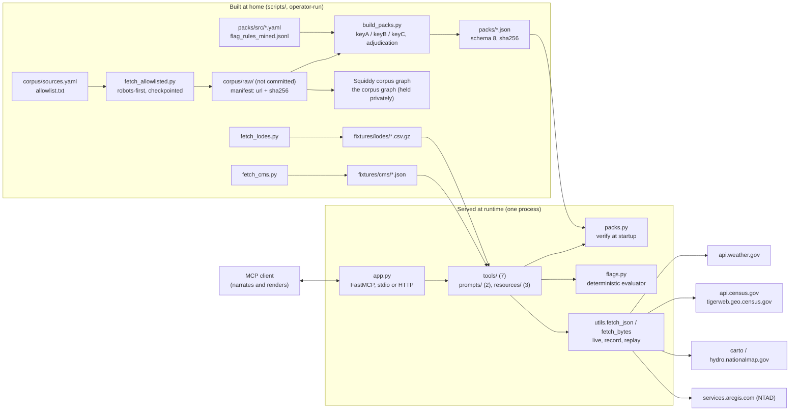
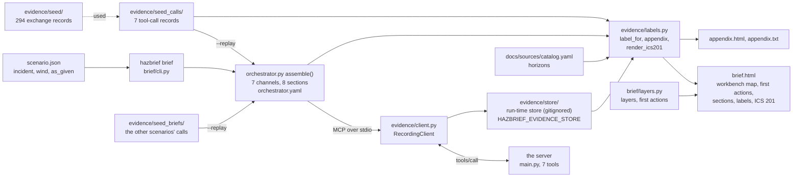

# Architecture

**Task:** `HB-26` (HB-26).
**Scope:** DN-001 (`DN-001`) and its amendments, DN-002 to DN-011.

This note states the system as built. HB-26 read sections 1 to 10 from the code at commit `ed26c53`.
HB-34 brought sections 2 and 10 to its own commit, and HB-42 added section 11, the application
layer, read from the code at `5282b29`. It adds no design.
Each section names the files it describes. Where the code and a design note disagree, this note
describes the code, and the disagreement is listed in section 10. The requirements trace is
[`REQUIREMENTS_TRACE.md`](REQUIREMENTS_TRACE.md); the security considerations are
[`SECURITY.md`](SECURITY.md).

## 1. The two halves

The repository holds two systems that share one package, and an application that calls the first
(section 11).

* **Served at runtime:** one MCP server process (`src/hazbrief/`). It reads six verified JSON
  packs, two cached file sets and six live federal services. It writes nothing upstream and calls
  no model.
* **Built at home:** the corpus, the pack builder, the cache fetchers, the fixtures and the
  evaluations (`corpus/`, `scripts/`, `packs/src/`, `packs/build/`, `the corpus graph (held privately)`,
  `fixtures/`, `eval/`). These make model calls and network calls under the operator's control,
  and none of them runs inside the server.
* **The application** (`src/hazbrief/evidence/`, `src/hazbrief/brief/`; HB-39 to HB-41): a client of
  the server over MCP. It records every call it makes and writes a labelled brief, with a labelled
  first-order puff beside the ERG footprint (DN-018). The server never imports it, and the
  container image does not hold it (section 11).

The boundary is the files: the server reads `packs/*.json`, `fixtures/lodes/` and `fixtures/cms/`,
and the stylebook under `docs/stylebook/`. Nothing else crosses. No database is opened at runtime
(DN-001 section 4 invariant 3); `pyproject.toml`'s runtime dependencies name no database driver.

The Squiddy graph is drawn beside the pack build, not into it. Section 4 says why.

## 2. The runtime process

**Entry and transport** (`main.py`, `src/hazbrief/app.py`). `app.py` creates the `FastMCP`
instance with the server's instructions and calls four aggregators. `main()` picks the
transport in this order:

1. a platform port (`DATABRICKS_APP_PORT` or `PORT`): HTTP on `MCP_HOST` at that port;
2. `MCP_TRANSPORT=streamable-http`: streamable HTTP on `MCP_HOST`:`MCP_PORT`;
3. otherwise stdio, which is how Claude Desktop, Claude Code and the agent evaluation launch it.

Over HTTP the server serves `/mcp`, plus `/health` and `/version` (`routes.py`). The HTTP route
is local only until authentication lands (HB-89; [`SECURITY.md`](SECURITY.md) section 10):
`MCP_HOST` defaults to `127.0.0.1`, both paths run behind fastmcp's strict Host and Origin
guard (`app.http_options`), the container widens the bind inside its own namespace and is
published on `127.0.0.1`, and `server.json` lists no remote. The server masks the text of any
exception a tool raises (`mask_error_details=True`); a tool's expected failures are returned
`error` and `hint` values.

**Registration.** `tools/__init__.py`, `prompts/__init__.py` and `resources/__init__.py` each import
one module per item and call its `register(mcp)`; `app.py` holds no tool logic. Inputs are Pydantic
models in `models.py`, every one with `extra="forbid"`, bounded strings and ranged numbers. A model
derived from `ToolInput` accepts an object sent as a JSON string once and says so in the output
(`json_string_notices`). It never repairs malformed JSON.

**The tools** (`src/hazbrief/tools/`). Every tool is annotated `readOnlyHint: true`. Each docstring
states its data source, update cadence and as-of behaviour (DN-001 section 7).

| Tool | Module | Input model | Reads | `openWorldHint` |
|---|---|---|---|---|
| `assess_incident` | `assess_incident.py` | `IncidentInput` | packs; sunrise and sunset by the NOAA equations (`astral`) | false |
| `protective_action_footprint` | `protective_action_footprint.py` | `IncidentInput`, `WindObservation` | packs; NWS forecast grid when no wind is given | true |
| `population_at_risk` | `population_at_risk.py` | `PopulationInput` | TIGERweb, Census Data API (DHC, ACS, CRE); `fixtures/lodes/` | true |
| `facilities_in_footprint` | `facilities_in_footprint.py` | `FacilitiesInput` | USGS Structures, USGS 3DHP, BTS NTAD; `fixtures/cms/` | true |
| `receiving_hospitals` | `receiving_hospitals.py` | `ReceivingInput` | `fixtures/cms/` only | false |
| `material_response_guidance` | `material_response_guidance.py` | `IncidentInput` | packs only | false |
| `build_ics_201` | `build_ics_201.py` | `Ics201Input` | the six tools above, TIGERweb places, counties and roads, NWS points | true |

**The prompts and resources.** `prompts/ics201_brief.py` registers `ics201_brief`, which lists the
seven tools in DN-001 section 7 order and carries the commander stylebook's full text.
`prompts/decision_support.py` registers `decision_support` (HB-207; DN-029 ADDENDUM-00): what to
know, suggested actions to consider and by when. It sequences five tools and carries the
suggested actions pack (`packs/suggested_actions.json`, built from
`packs/src/suggested_actions.yaml` with every quotation re-read on its held page): each entry a
condition on tool result fields, a held quotation or the ERG guide's own cell, who acts where
the source says, and by when only as the sources order and range it. The client tests the
conditions, writes each entry that holds with its source, adds none of its own, names a
condition no entry answers, and computes no clock time. It is marked a demonstration, and the
incident commander decides. Three
resources serve shipped files: `hazbrief://stylebook/commander`,
`hazbrief://stylebook/vocabulary` (`resources/stylebook.py`) and `hazbrief://attribution`
(`resources/attribution.py`), read from `docs/stylebook/` by `stylebook_files.read_shipped`.

**Startup checks.** The tools load the packs at registration (`packs.default_packs`), and the
prompt reads the stylebook at registration. A missing or altered pack, or a missing stylebook,
stops the server before it serves a request.

**The supporting modules.**

| Module | What it does |
|---|---|
| `incident.py` | ERG reasoning shared by the assessment and the footprint: ID, name, placard and guide resolution; day or night; the table that applies; ambiguity candidates; `basis` source tags |
| `geometry.py` | The ERG shapes as GeoJSON: the isolation circle and the downwind square, laid out in an azimuthal equidistant projection about the spill and carried back by the WGS84 geodesic (`geographiclib`) |
| `geo.py` | The footprint as one shapely geometry; each Census unit's geodesic share of area inside it |
| `census.py`, `population_sources.yaml` | TIGERweb geography, DHC, ACS and CRE reads; derived margins of error by the ACS Handbook formulas |
| `lodes.py` | Jobs by block from the cached LODES WAC files |
| `facilities.py`, `facilities_sources.yaml` | Structures, 3DHP and NTAD queries; the CMS file reader; zone assignment |
| `nws.py` | The NWS `points` and `gridpoints` reads; the wind value whose interval holds the incident time |
| `place.py` | The place or county at the spill, from TIGERweb, for Block 1 |
| `flags.py` | The flag evaluator (section 6) |
| `ics201.py`, `ics201.yaml` | The ICS 201 configuration, the sentence and receipt types, the Markdown rendering |
| `ics201_map.py` | The Block 4 SVG sketch over a TIGERweb roads image |
| `stylecheck.py` | The deterministic stylebook checker over `docs/stylebook/STYLECHECK.yaml` and `VOCABULARY.yaml` |
| `packs.py` | The pack loader (section 4) |
| `utils.py` | The one upstream HTTP client and its recorder (section 5) |
| `config.py` | Settings from the environment and two dotenv files (DN-004) |
| `models.py` | Tool input models and the typed form of every pack |

Two modules in the package are build-time code that the server never imports:
`receipt_quotes.py` and `concept_topics.py`. They read Squiddy graph exports for the corpus-claim
work (HB-19, HB-20) and are kept in the package so that this interpreter and Squiddy's can both
import them. The standing verdict on a claim is the kit's reading (squiddy SQ-049R,
`claim_ruling.standing`), which `served_verdicts.py (a build tool held privately)` asks for; HB-71 retired the package's
own copy, `claim_verdicts.py`.

The application packages, `hazbrief.evidence` and `hazbrief.brief`, are described in section 11.

## 3. Configuration

`config.py` reads, highest first: an exported environment variable, the repository's `.env`, then
the operator's master file (`~/.secrets/master.env`, or the path in `HAZBRIEF_MASTER_ENV`). Every
upstream origin is a setting (`NWS_API_BASE_URL`, `CENSUS_API_BASE_URL`, `TIGERWEB_BASE_URL`,
`USGS_STRUCTURES_BASE_URL`, `USGS_3DHP_BASE_URL`, `BTS_NTAD_BASE_URL`), and so are the timeout
(`UPSTREAM_TIMEOUT_SECONDS`), the response size cap (`UPSTREAM_MAX_RESPONSE_BYTES`), the HTTP mode,
the cache directories and the circle vertex count. A tool names an API, never a URL.
`.env.example` names both credentials and the settings an operator usually sets. Every `Settings`
field can be set by the variable of its name, and `.env.example` does not list them all (it omits
`CENSUS_API_BASE_URL`, `TIGERWEB_BASE_URL`, `USGS_3DHP_BASE_URL`, `HAZBRIEF_LODES_DIR` and
`ERG_APP_MATERIAL_URL`). [`SECURITY.md`](SECURITY.md) section 3 covers the secrets.

## 4. The packs

**What they hold** (`packs/SCHEMA.md`, `models.py`). Six kinds, one file each: `erg`, `cfr172`,
`cameo`, `hazard_classes`, `flag_rules`, `vocabulary`. They carry reference knowledge only, never
live data (DN-003 section 1). Counted from the files at this commit:

| Pack | Version | Holds |
|---|---|---|
| `erg.json` | `erg2024.5` | every yellow-index ID number with its ERG rows, 62 orange guides, the placard table, the four unnumbered explosive rows |
| `cfr172.json` | `cfr2025.1` | 49 CFR 172.101 rows for the eight seed materials |
| `cameo.json` | `cameo3.1.0.1` | CAMEO datasheets for the eight seed materials |
| `hazard_classes.json` | `dn001.1` | the four DN-001 hazard classes, each with its rule set and members |
| `flag_rules.json` | `hb18.1` | the flag rules (section 6) |
| `vocabulary.json` | `hb03.1` | the pack-side vocabulary terms with their receipts |

**How they are built at home.** `scripts/fetch_allowlisted.py` fetches the documents
`corpus/sources.yaml` names into `corpus/raw/` (not committed). Provenance is url and sha256 in
the fetch log and the Squiddy manifest. `scripts/build_packs.py` parses every value by locator from
a held file, and takes each source's sha256 and licence from `squiddy_intake.py (a build tool held privately)`'s join,
so the corpus's own records are the provenance. The ERG is triple keyed. Key A is the PDF text layer
(`erg_keya.py`). Key B is a reading of the rendered page (`erg_keyb.py`). Key C is PHMSA's ERG2020
data files (`erg_keyc.py`). Then `erg_join.py` and `erg_adjudicate.py` decide field by field. A field
on which all three keys differ is stored as null and listed in `packs/build/UNRESOLVED.md`, never
guessed. The seed rows are cross-checked against PubChem and CAMEO (DN-003 section 5). A build is
deterministic: `built_at` is the newest source's retrieval instant, not the wall clock, so the
same held files rebuild byte-identical packs (`test_packs.py (a test held privately)`).

**The Squiddy graph's role.** `the corpus graph (held privately)` is the corpus inventory and the claim
graph (LN-06, LN-09 to LN-12). No pack is exported from it. The packs are parsed from the held
files by page locator, as DN-003 section 5 decided after search ranking proved too coarse for
table rows. Section 10 lists this against DN-001's wording.

**How they are read at runtime** (`packs.py`). `load_pack` refuses a pack, never half-uses one,
when its `schema_version` is not in `SUPPORTED_SCHEMA_VERSIONS` (8), its `kind` has no model, the
sha256 of its canonical `data` differs from the `sha256` it carries, or it fails its Pydantic
model, which forbids unknown fields. `default_packs()` loads and verifies all six once per process.
Every pack also carries `sources` (doc id, raw sha256, locator, licence) and `attribution`.

**Cached files that are not packs.** Two data sets are fetched once at home and read from disk at
runtime, because their sources are files, not query APIs:

* `fixtures/lodes/`: LEHD LODES8 WAC state files, by `scripts/fetch_lodes.py`, with
  `MANIFEST.json` carrying url, sha256 and the LEHD citation. Corridor states only (MD, PA, VA,
  DC); a block in another state is reported in `missing_states`.
* `fixtures/cms/`: CMS Hospital General Information joined to Provider of Services beds and
  geocoded, and Nursing Home Provider Information, by `scripts/fetch_cms.py`, each with a `meta`
  block carrying its as-of.

## 5. The live sources and the HTTP client

**One client** (`utils.py`). Every upstream call goes through `fetch_json` or `fetch_bytes`. It
joins a validated relative path to the configured origin, refuses absolute URLs, `..` segments
and encoded escapes (`_validate_relative_path`), follows no redirect, ignores proxy and netrc
settings from the environment (`trust_env=False`), applies the timeout and the response size cap,
and turns every failure into an `UpstreamServiceError` that carries no upstream text. A response
that names a next URL (the NWS `points` response) is followed only under the same configured
origin (`relative_to_origin`). Every request sends `User-Agent: hazbrief-mcp/<version> (+<contact
url>)` (DN-002 section 1).

**Three modes** (`HAZBRIEF_HTTP_MODE`; DN-005 section 2). `live` calls and writes nothing.
`record` serves an exchange that has a file and records one that has none (vcrpy's
`new_episodes`). `replay` serves files only and refuses anything else (vcrpy's `none`); it is the
test suite's default (`tests/conftest.py`). An exchange file is keyed by the sha256 of method, url
and body. The `key` and `$$app_token` query parameters are stripped from the url it is stored
under, and a write is refused if any configured secret appears in it.

**Each source and its as-of.**

| API name | Origin | Used for | As-of returned |
|---|---|---|---|
| `nws` | `api.weather.gov` | wind at the point and time (`nws.py`); the spill point's time zone (`build_ics_201`) | the grid's `updateTime` and the response's Date, Last-Modified, Expires and Cache-Control headers; a time the grid does not cover is refused |
| `census` | `api.census.gov` | 2020 DHC P1 and P18 by block; ACS 2020-2024 5-year by block group or tract; CRE 2024 by tract | each count's `as_of` and `basis` tags, with the vintage from `population_sources.yaml` |
| `tigerweb` | `tigerweb.geo.census.gov` | 2020 tabulation blocks, block groups and tracts; the place and county at the spill; the roads image for Block 4 | the vintage the service states; for the roads export, which states none, the retrieval date |
| `usgs_structures` | `carto.nationalmap.gov` | schools, colleges, hospitals, fire and EMS, ambulance, police | each facility's load date, read from the response |
| `usgs_3dhp` | `hydro.nationalmap.gov` | flowlines and waterbodies | the refresh date the service states, held in `facilities_sources.yaml` when it was read (not re-read per call) |
| `bts_ntad` | `services.arcgis.com` | North American Rail Network lines; FRA grade crossings | each layer's stated update date, held in `facilities_sources.yaml` the same way |

The Census Data API needs `CENSUS_API_KEY`. Without it `population_at_risk` returns `error` with
the signup URL, `build_ics_201` reports that tool in `errors` and fills the other blocks, and every
other tool works (DN-001 section 4 invariant 3 as amended by DN-003 section 1). A source that fails
inside `facilities_in_footprint` is listed in `errors` with its section null; the others answer.

## 6. Flags are data

**The rules** (`packs/flag_rules.json`, built from `packs/src/flag_rules.yaml`,
`flag_rules_table.yaml`, `flag_kinds.yaml` and `flag_rules_mined.jsonl`). The pack holds 173 rules:
9 authored (group quarters, schools, hospitals, no-vehicle households, limited English, CRE, TIH
distance, waterways, rail), 1 table rule (FR-AMB-01, an ambiguous load) and 163 guide rules, one
per orange guide and cross-cutting kind. A guide rule's trigger text was admitted only when it is a
verbatim substring of the Key A text of the page it cites. Each rule is an alarm in the ISA-18.2
sense (DN-006): a predicate over named tool values, a priority, an ERG consequence and an ERG
response by locator, and receipts. Twenty-six guide rules are dormant: their input
`low_lying_areas_in_footprint` comes from no tool yet.

**The evaluator** (`flags.py`). `applicable` takes the material's hazard class rule set, its
guide's rules and the table rules. `evaluate` fires a rule when its predicate, or a cause merged
into it, holds. A rule whose inputs are not all supplied does not fire and names what is missing.
A fired rule's sentence is its template filled from the values. There is no model and no ranking
by text. `for_briefing` prints at most ten alarms, high then medium then low, and counts the rest
as withheld. The structured output keeps every fired flag (DN-006 section 3.6).

**Where flags fire.** `protective_action_footprint` evaluates the rules it can read from its own
values and returns `flags`. `build_ics_201` evaluates them over the `flag_inputs` of the
footprint, population and facility outputs. The tools only supply inputs; no tool decides what is
alarming (DN-001 section 4 invariant 2).

## 7. The ICS 201 as a composition

`build_ics_201` (`tools/build_ics_201.py`) runs the server's own tools on the incident rather than
taking their outputs from the caller, so that every receipt points into an output this server made.
`_run_tools` calls them in this order: the footprint (which re-derives the assessment), the
assessment and the guidance (for an unresolved load, as its governing candidate), the population,
the facilities and the receiving hospitals in that footprint, then the TIGERweb place and the NWS
time zone. The calls are sequential. A tool that returns an error is listed in `errors`, its lines
say so, and the other blocks still fill.

**Blocks** follow the held FEMA form's numbering (`ics201.yaml`). Blocks 1, 3, 4, 5, 6, 7 and 10
are filled. Blocks 2, 8 and 9, and the names and signature, are left blank for the Incident
Commander. Block 4 is
the GeoJSON and, on request, an SVG sketch (`ics201_map.py`). Block 7 states the isolation and
protective action objectives, quotes the ERG, and names the zone for which the Incident Commander
chooses evacuation or shelter-in-place from the ERG decision factors (SB-STR-06). Annex A lists
every limit and every source with its as-of.

**Receipts.** Every sentence is either a template filled from a tool output value or an ERG
sentence quoted from a pack (`ics201.sentence`, `ics201.quotation`). A receipt is a tool output
path with its value, or a document and page. A sentence of Blocks 5, 7 or 10 without a receipt
fails the build. Every sentence that is not a marked quotation is checked by `stylecheck`, and the
findings are returned in `style_findings`.

**Size.** `response_format: concise` (the default) returns the Markdown form, the source tags, the
GeoJSON, `errors` and `pack_versions`, which fits Claude Code's default cap on a tool result.
`detailed` adds the blocks with receipts, Annex A and the fired flags, and `block` returns one part
at a time. `include_map_svg` adds the sketch and takes the result over the cap (LN-07 F1, HB-18).

## 8. Fixtures and replay

`docs/FIXTURES.md` is the format, written from the code. In short:

* `fixtures/exchanges/<api>/` holds the recorded upstream GETs.
* `fixtures/scenarios.yaml` is the derived manifest of 18 scenarios and what replay does with each
  tool on each.
* `fixtures/scenario_gaps.yaml` declares every cell that does not replay.
* `fixtures/scenarios/<id>.json` are the golden-master snapshots.
* `fixtures/ics201/` holds frozen forms and sketches.

`test_scenario_manifest.py (a test held privately)` fails a gap with no declaration.

## 9. Evaluation

**The test suite** (`tests/`, `uv run pytest tests/ -q`) runs in replay. The gate is local: the
dispatcher runs `uv run pytest tests/ -q -p no:cacheprovider -n auto --maxprocesses 6 --dist loadfile -m 'not slow
and not load_sensitive' && uv run pytest tests/ -q -p no:cacheprovider -n 3 --dist loadgroup -m 'load_sensitive and
not slow' && uv run ruff check . && uv run ruff format --check .` in each task's worktree before every merge
(`the Seldon configuration (held privately)` `dispatch.gate_command`; lint joined it in HB-105; since HB-164 the suite runs in
parallel, one test module per worker; since HB-194 the tests that launch headless Chrome, assert a
wall-clock bound, or start a server or bind a port carry the `load_sensitive` mark and run in a
second step after the parallel one, one group per kind so at most one test of a kind runs at a
time, and every collected test runs in exactly one of the two). The GitHub workflows run only when a person starts one by hand (HB-85): `.github/workflows/ci.yml`
runs ruff check, ruff format check and the suite on a clean runner. The exhaustive invariant
tests are marked `slow` and run locally before a release tag or by hand in
`.github/workflows/eval-nightly.yml`.

**The harness** (`eval_harness.py (a build tool held privately)`, `eval/harness.yaml`; results in LN-05). Three parts,
each a named method:

* **A, invariants** (no network): bounded-exhaustive over the whole finite input domain (Sullivan
  et al., ISSTA 2004): every ID number and name, every Table 1 and Table 3 cell, every guidance
  input combination, every flag cause by unique-cause MC/DC (Chilenski and Miller 1994), and the
  provenance of every distance to its pack cell.
* **B, regression** (no network): every tool on every scenario against its golden master
  (Feathers 2004), the `expected.json` entries and the frozen forms.
* **C, live drift** (network, recorded, ceilinged by call count): the scenarios re-recorded live
  into `fixtures/exchanges_live/<date>/` and diffed against replay.

**The agent evaluation** (`scripts/agent_eval.py`, `eval/agent_prompts.yaml`; results in LN-07).
The Claude Code CLI pinned by the operator's model lock, connected to this server over stdio with
every tool call replayed, runs a fixed prompt set of scenario, ambiguity, out-of-scope and
adversarial messages, three runs per prompt per model. Scoring is deterministic: tool precision
and recall, argument matching on the fields that matter (BFCL), grounding of every number and name
in the reply against the tool outputs, refusal, and pass^k (τ-bench). No model judges a model.
Each episode is checkpointed by a key over prompt, model, CLI version and the tool surface's hash.

The template's `eval/README.md` described a Phoenix harness that was not built. HB-34 rewrote it to
describe this harness (D-5). LN-05 says why there is no Phoenix: "As built, no model writes any
sentence (HB-11), so there is no model trace to score."

## 10. Code against the notes

Each row is a place where a design note, a lab note or a shipped document says one thing and the
code does another. This note describes the code. None was fixed by HB-26, which wrote it. HB-34
fixed D-5, D-8, D-9, D-10 and D-11, and each of those rows says how. HB-42 added D-12 to D-14, where the
application layer as built departs from DN-010 and DN-011 as written.

| # | Document says | Code does | Where |
|---|---|---|---|
| D-1 | DN-001 section 4 invariant 3: "The knowledge graph is built at home ... the server ships exported packs" | No pack is exported from the Squiddy graph; `build_packs.py` parses the held files by locator. DN-003 section 5 made that choice; DN-001's wording still reads as an export | `scripts/build_packs.py` |
| D-2 | DN-001 section 5: TIGER roads and rail | Roads come from TIGERweb `Transportation` (Block 4 image only); rail comes from BTS NTAD and FRA crossings, not TIGER | `facilities_sources.yaml`, `ics201.yaml` |
| D-3 | DN-001 section 5: nursing homes and prisons from USGS Structures | Nursing homes come from CMS Nursing Home Provider Information (DN-002 section 4 moved them to CMS); prisons are not listed as facilities; correctional residents are counted as group quarters by `population_at_risk` | `facilities.py`, `population_sources.yaml` |
| D-4 | DN-002 section 4: the flammable-liquid rule "cites waterways and source water protection areas" | FR-WATER-01 reads waterways only; its `gaps` says source water protection areas are not an input | `packs/src/flag_rules.yaml` |
| D-5 | DN-001 section 6 item 5: Phoenix or equivalent; the template's `eval/README.md` is still the Phoenix stub | A deterministic harness and a deterministic agent scorer; no Phoenix | `eval_harness.py (a build tool held privately)`, `scripts/agent_eval.py`, `eval/README.md`. Fixed by HB-34: `eval/README.md` describes the harness |
| D-6 | `prompts/ics201_brief.py` describes `facilities_in_footprint` as "schools, nursing homes, prisons and hospitals" | The tool lists no prisons (D-3) | `prompts/ics201_brief.py` `TOOL_SEQUENCE` |
| D-7 | Each flag rule carries `modes: [highway, rail]` | `flags.applicable` never reads `modes`, and no input names the mode; the Table 3 container carries it | `flags.py` |
| D-8 | `packs/SCHEMA.md` title: "schema version 6"; its version 3 note: "all 64 orange guides" | The packs are schema version 8; `erg.json` holds 62 guides (121 and 167 print no guidance, per `material_response_guidance`'s hint) | `packs/SCHEMA.md`. Fixed by HB-34 |
| D-9 | README Evaluation: "14 scenarios, 7 tools: 93 scenario-tool outputs ... 4 frozen files" | The latest regression report (`eval/reports/2026-10-25_regression.json`, committed by HB-36; before it `logs/2026-10-23_HB-05_regression.json`): 18 scenarios, 121 outputs, 12 frozen files, 0 differences | `README.md`. Fixed by HB-34 |
| D-10 | `requirements.txt`: "kept in sync with pyproject.toml" | It omits `shapely`, a runtime dependency, so the cloud.gov buildpack install would lack it | `requirements.txt`. Fixed by HB-34: it is the `uv.lock` export, checked by `tests/test_requirements.py` |
| D-11 | `Dockerfile` header: the image serves the server | The image copies `src/`, `docs/stylebook/` and `packs/` only. `fixtures/lodes/` and `fixtures/cms/` are not copied. Read from the Dockerfile, not built: in the image, daytime jobs would report every state in `missing_states`, `receiving_hospitals` would return `error`, and `facilities_in_footprint` would list its nursing home source in `errors` | `Dockerfile`, `config.py`. Fixed by HB-34: both are copied, `test_container_image.py (a test held privately)` fails on any runtime path no COPY covers, and part B regression run inside the built image gives 0 differences |
| D-12 | DN-010 D2: the entity at `<sha256>.json`, "the record beside it is `<sha256>.prov.json`" | A second call returning the same bytes is a second record, so each record is `<sha>.<activity id>.prov.json`. A response that is not JSON (the TIGERweb roads image) is `<sha>.bin`, hashed over its bytes | `src/hazbrief/evidence/store.py` (HB-39) |
| D-13 | DN-011 D1: each channel's timeout "taken from the source catalog ... and falling back to a per-tool default in `orchestrator.yaml`" | The catalog states no timeout, so every channel uses its per-tool default | `src/hazbrief/brief/orchestrator.yaml` (HB-41) |
| D-14 | DN-010 section 3.4 and HB-39 step 6: the seed is migrated "into the store", committed as an exception to its gitignore | Two seed stores of their own, committed whole: `evidence/seed/` (the exchanges) and `evidence/seed_calls/` (the seven tool calls, HB-40). `evidence/store/` is ignored entirely, so a working store never rewrites a tracked manifest | `.gitignore`, `src/hazbrief/evidence/evidence.yaml` |

## 11. The application layer

**Tasks:** HB-39 to HB-41. **Notes:** DN-009 C1 to C6; DN-010 and its ADDENDUM-00; DN-011 and its
ADDENDUM-00.

**The boundary.** The application is a client of the server. It reaches the seven tools only
through MCP:
* it spawns `main.py` over stdio and calls tools by name with the surface's own schemas;
* it imports nothing from `hazbrief.tools`;
* the server's surface is unchanged (`fded04ec6c0e`, `test_double_wrap_hint.py (a test held privately)`
  `test_the_tool_surface_is_hb36s`).

The application's code is `src/hazbrief/evidence/` and `src/hazbrief/brief/`, reached through
`src/hazbrief/command.py`. The server imports neither (`tests/test_evidence_store.py`
`test_no_server_module_imports_the_application`). `scripts/runtime_paths.py` leaves them out of
the paths the runtime reads. `.dockerignore` leaves both packages and the application's three
packs out of the container image. The image stays the server alone (DN-011 section 3;
`test_container_image.py (a test held privately)` `test_the_image_holds_none_of_the_application`, HB-87R).
`command.py` stays in the image as the console entry point. It imports the application only
inside `hazbrief brief`: in the image that command fails, and the server does not.

**The server runs no dispersion model; the application draws a labelled modelled cloud.** The
seven tools run no dispersion model. Every distance a tool returns is a cell of the ERG 2024
tables or guides. No tool result and no ICS 201 carries a modelled value. The `hazbrief brief`
application is a client of the server, not part of it. Beside the ERG footprint, it draws one
modelled cloud by health-effect level (AEGL-3, AEGL-2 and AEGL-1) from the one engine a held
criterion names for the release: the critical Richardson number of NOAA's NOS OR&R 43 classes the
release dense, passive or not classed (DN-026; `src/hazbrief/brief/engine_rule.py`). A dense
release is drawn by SCICHEM, run in a separate models image on the forecast wind hour by hour
(DN-028; `src/hazbrief/brief/scichem.py`, `src/hazbrief/brief/cloud.py`); by day, where no hour of the brief's horizon is a stable class, SLAB runs beside it as its second method, a layer off by default on one wind (DN-020; `src/hazbrief/brief/dense_gas.py`), and where
the two disagree beyond the held factor of three, the checklist carries one warning with both results; that is the rule, and no committed brief meets its condition, so no committed brief raises the warning (Issue afab181e; HB-189; HB-173; `src/hazbrief/brief/agreement.py`). Where any hour of the brief's horizon is a stable class, as at night or where an afternoon release runs into the evening, the moving cloud is the primary layer: SCICHEM's run by level, hour by hour, at a stated 1.25 m vertical setting, an approximation that is not converged, held as a frame every 15 minutes of cloud time on a coarse mesh whose level outlines are drawn from it, each frame shown as it is computed, with one Play control off by default (DN-024 ADDENDUM-01; HB-192); SLAB checks how far, its area drawn to where a level closes or to the release hour's wind's travel in the horizon and 30 percent over, a dashed outline with no times beside the filled cloud; counts and candidate blocks are stated for AEGL-3 and AEGL-2, every time is the 1.25 m run's and no warning is raised (HB-189; `src/hazbrief/brief/conditions.py`). Each engine's conditions of use are a section of the brief's TEVV page. The benchmark requirement is another, Benchmarks and requirement: its minimum, its objective and hazbrief's status against each published benchmark: on Jack Rabbit II Trial 7's five arcs at 0.2 to 5 km, where by the one-minute rule its SCICHEM run is within a factor of two of the measured arc maximum at 1 arc and its SLAB run at 4, against 3 and 4 for HPAC's two published runs and 3 for ALOHA's; against the measurements its SCICHEM run is below them, a difference that is statistically significant at the 95 percent confidence level (MG 2.88, 95 percent limits 1.58 to 5.27), and no other run's difference from them is statistically significant at that level; against the tools no hazbrief run's difference in mean bias is statistically significant at the 95 percent confidence level (one trial, five arcs of one release; `docs/evidence/hb212/states.tsv`); not yet evaluated on the others (HB-206; HB-209; HB-212; HB-213); the accepted tools are named there and on no map page (HB-192). A passive release is drawn by a first-order passive Gaussian puff that starts on its
release hour's wind and is then carried on each later forecast hour's wind (a stated or observed
wind is one wind for every hour), by level like the dense cloud (DN-025); it is not a dense-gas
model, and no committed brief is passive. Its code is `src/hazbrief/brief/puff.py`. Its packs
are `packs/sigma_curves.json`, `packs/materials_properties.json` and
`packs/release_scenarios.json`, which `packs.load_app_pack` reads and `default_packs` never
does. A release the criterion cannot class draws neither and says why, and nothing from an
engine the criterion did not name is drawn. Each modelled layer has a section on the brief's
TEVV page (`src/hazbrief/brief/tevv.py`); none of the modelled layers is validated against
observations of a release; the two dense engines, as hazbrief runs them, are compared with the measured arc maxima of stable dense field trials at 212 to 800 m: SLAB within a factor of two at all 10 (four trials), SCICHEM below 7 of 8 (three trials) by a factor of 1.8 on geometric average when scored as its authors score a peak, and its mean, which the brief draws, below all 8 by a factor of 3.5 at the shipped 250 m setting; at the 1.25 m setting a stable brief now runs, every trial arc still reads below the measurement (HB-187) (`docs/evidence/hb159/tevv_rows.md`; `docs/evidence/hb176/summary.tsv`; `docs/evidence/hb177/hb176_restated.tsv`). The ERG footprint is the
protective action distance. Every ERG guide is routed: where its chemistry takes a release model, the modelled layers apply; where it
does not (explosives, radioactive materials, oxidisers, solids and others), the brief says so in the
guide's own words and draws neither (HB-120; `packs/release_routing.json`,
`src/hazbrief/brief/routing.py`).
Smoke from a fire is a future use: a fire brief names the VSMOKE layer and draws no band, because
no held open engine builds and reproduces its manual's example (HB-150; operator decision of
2026-11-09).
The container image ships the server alone, without the modelled
layers' code or packs.

**The second image: `hazbrief-models` (HB-111; DN-020 section 3.2).** The dense-gas model
runs in its own image beside the application, never in the server's. `deploy/models/Dockerfile`
compiles SLAB from the held archive, checked by sha256. Its build runs SLAB's four test cases
and fails outside HB-102's tolerance. The image's only entry is a standard-library driver: an
input deck on stdin, SLAB's output on stdout, no port. The application's client,
`src/hazbrief/brief/dense_gas.py`, writes the deck from HB-110's source term and the weather. It
runs the deck with `docker run --rm -i --network none`, or through the binary `HAZBRIEF_SLAB_BIN`
names for development. It reads the output into a footprint at AEGL-2 in the azimuthal frame
the ERG zones use. The image is optional: without it the client returns a one-line `error` and
`hint`. No brief layer reads the client yet (HB-112). The server image holds none of it
(`test_container_image.py (a test held privately)` `test_the_image_holds_none_of_the_models_image`); the models
image has its own tests (`test_models_image.py (a test held privately)`) and its security note is
`docs/SECURITY.md` section 11.

**The live page (HB-130R; DN-022 sections 3 and 8).** `assemble(on_event=...)` sends the
blackboard as a stream of typed events: `run_started`, `channel_started`, `channel_settled`,
`section_settled`, `alert`, `narrative` and `run_finished`. A `section_settled` carries the
static page's own fragment for that section (`render.page_parts`), and a section whose fragment
changes after it settled settles again. `run_finished` carries the sha256 of the static page of
the same records and `now`. `hazbrief brief SCENARIO.json --serve` serves the stream from
`src/hazbrief/brief/web.py`, a Starlette application bound to loopback by default
(`orchestrator.yaml` `web.host` and `web.port`, 127.0.0.1:8790; the route has no authentication,
HB-89). It serves three routes: the page shell at `/`, the events over Server-Sent Events at
`/brief/<id>/events`, and the static page of the finished run at `/brief/<id>/page`. It refuses
a foreign Host or Origin with 403 and a taken port at start. The page's script
(`src/hazbrief/brief/static/live.js`, no framework) swaps each settled fragment in and counts the
sections settled. When the run finishes, it checks `/page`'s sha256 against the stream's. A
replayed brief streams the same sequence every run (`the HB-130 evidence (held privately)`,
`test_hb130_event_stream.py (a test held privately)`). Like the rest of the application, it is not in the server
image.

**The start page (HB-208).** `uv run hazbrief brief --serve`, with no scenario, opens on a start
page (`src/hazbrief/brief/start.py`) with two parts. The first lists every scenario under
`fixtures/scenarios/` that has a committed brief, each cell read from the scenario's record: the
place, the material by its ERG name and ID number, the container, the time the run is for and
day or night. "Open the recorded run" (`POST /start/recorded`) makes the server's one brief that
scenario's served replay, whose static page is the committed `brief.html`. "Run it with today's
conditions" (`GET /entry?scenario=<id>`) opens the entry form filled with the scenario's
material, container, quantity and point, now as the start time and the forecast as the weather;
nothing is built until Build. The second part is the entry form (`GET /entry`). One server
serves one brief.

Since HB-154 (DN-019 ADDENDUM-03) the live page is a fixed shell that fills the window and never
scrolls. The header carries the EXERCISE banner, one line (the material, the container, the
place, the as-given time, the wind record, "Print the ICS 201") and, on a replay, the replay
banner. Under it, one row: the layers and their legend in a collapsible left column, the map in
the centre with its view and overlay switches at its top right and a tabbed panel under it
(closed on first paint), and the operator checklist in a collapsible right column. The
checklist (HB-141) holds the cue lines, the integrity items, the flags in priority order, each
degraded section's label and one line per source, each with its receipt and a checkbox whose
tick is an event on the stream; a line a later settle made false is struck through, not
removed. It exists to remind the reader to think critically about the brief and the quality of
its information (the uncertainty of the assumptions, the fidelity of the models, the timeliness
of the data), not to be completed (`hazbrief-mcp:HBD-324`). The panel's tabs hold the
sections, the guide's slices, the evidence log (one row per call, each opening its record from
`/brief/<id>/record/<sha256>`), the Data sources view (`/brief/<id>/sources`: every MCP server
and public source with one of four outcomes, built from the records, no call) and the
commander's report (`/brief/<id>/report`: the ICS 201 and its evidence appendix), whose print
view prints the report under the EXERCISE banner and nothing else. The page has no question
box (HBD-271); the question route (`POST /brief/<id>/ask`;
`src/hazbrief/brief/model_author.py`) stays a server-side capability. It sends one call of the
pinned Claude Code CLI under `seldon models hold`, with no tools. The prompt file is
`src/hazbrief/brief/prompts/brief_model.md`, which the off-by-default model author also reads.
The route refuses an answer that cites a record outside the brief's set, carries a number no
record holds, names a tool the brief does not run, or proposes a view the page lacks. Every call
is recorded by its request hash, so a replay answers with no call (`the HB-131 evidence (held privately)`,
`test_hb131_panels.py (a test held privately)`).

Since HB-158 (DN-019 ADDENDUM-04) the shell shows less at once. Each layer row and checklist
item is one line that opens onto its detail; a layer with nothing there is a muted row, and one
that could not be had sits under one line, "N layers could not be drawn", and is a Data gaps
item in the same words. Every status reads one of three states, Retrieving, Retrieved (on a
replay, Recorded) or Could not retrieve, each with its own shape. An old source states its age
and limit, that it does not update by itself and what to do. The checklist, the layers and the
tabs wait for the critical set (`stage_reached`), and a later change to an item is marked
updated. The header carries a status strip, one mark per MCP server and channel, and the wind
chip's hour on the one clock. The six tabs end with "Sources and MCP servers", which opens with
the MCP servers table, then every source the brief called, one row each under Public federal
data, State and local data, Models, hazbrief's own tables and The basemap, each marked by a
shape and a word (answered, answered from the recording, not called, failed), read from the
brief's own records (HB-215); the static page reaches it by one link at its top. The display is one person's design from experience: improving it needs
design sessions and testing with responders, and the aim of this version is that a capable
person put in the chair can do a good enough job with it and that what it shows is believable.

**The modules:**

| Module | What it does |
|---|---|
| `evidence/store.py`, `evidence.yaml` | The content-addressed, append-only store. An entity is a response body, stored once under the sha256 of its canonical JSON (`packs.canonical_json`), or of its bytes for an image: `<sha[:2]>/<sha>.json` or `.bin`. Each activity is a PROV record beside it, `<sha>.<activity id>.prov.json`. The store also writes the RO-Crate 1.1 manifest, computes the staleness predicate `is_stale`, and refuses a record that holds a configured secret. `evidence.yaml` holds every path. |
| `evidence/catalog.py`, `docs/sources/catalog.yaml` | One row per source the seven tools read: endpoints, tools, horizon with its reason (`stated`, `assumed` or `computed`), terms, rate limit and provenance class. The catalog is the one place a horizon lives. |
| `evidence/client.py` | `RecordingClient`: the fastmcp client over stdio. Every tool call writes a record of the parameters, the two times, the server's HTTP mode, the package version, the surface hash, and the catalog's sources, class and shortest horizon. The call returns (entity hash, payload). |
| `evidence/exchange_records.py` | One recorded exchange file as an upstream exchange record: the GET as the activity, its body as the entity, the catalog row as the source (DN-010 s3.4). The seed migration (`scripts/migrate_exchanges_to_store.py`) and a served live brief's exchanges (HB-208) write through it. |
| `evidence/labels.py`, `labels.yaml` | `label_for(record, now, body)`: the label is read from the record, the tool's own `basis` tags and the catalog. It carries `sources[]`, each with its own as-of and horizon, and it is stale when any of them is. `appendix()` renders text, Markdown and HTML. `render_ics201()` lays out the tool's Markdown with each block's labels under it and the appendix after it. |
| `brief/orchestrator.py`, `orchestrator.yaml` | `assemble()`: one asyncio task per channel. A channel starts when its inputs exist: the three tools that take the footprint wait for it (DN-011 ADDENDUM-00). The blackboard holds each section as pending, rendered or degraded. Sections render in the D3 order. A timeout or a structured error degrades a section with "unavailable: \<source\>, \<reason\>, attempted at \<time\>", and nothing retries. `--replay` resolves every channel from the stores. `params_for` is the one parameter builder. |
| `brief/author.py` | The `NarrativeAuthor` protocol and `NoAuthor`, which returns the server's deterministic text (DN-011 D4). No model writes any sentence. |
| `brief/layers.py` | The workbench's layers (HB-45, DN-012 s3): the footprint's zones, spill point and a wind arrow; flags with a location; receiving hospitals; schools, care facilities, emergency services, grade crossings; rail lines, waterways and Census blocks, whose geometry the tool does not return and which are drawn from the exchanges its record `used`, matched by the ids it printed. Each feature's popup carries its label (`label_for`). A layer that cannot be drawn says why. Also the first-actions strip: the footprint's distances and the guidance tool's public-safety lines, nothing typed. |
| `brief/location.py` | The location record (DN-013 s2): a shape, its derivation, source, `accuracy_m` and `basis`, as-of and label. `caller_supplied` is the request's bare point, no accuracy (HB-48). `milepost` and `crossing` (HB-49) resolve, pure over recorded exchanges, from PennDOT's RMS segments cut at two interstate mile markers, MDOT SHA's 10th-mile milepoints, or the FRA inventory read through BTS NTAD, whose Lat/Long Source field sets the accuracy (1 m for `Actual`, none for `Estimated`; DN-013 ADDENDUM-00). Virginia is refused: VDOT's held layer is a legacy sign layer. `address` (HB-50): the Census Geocoder's one-line match is a point interpolated along one TIGER address range, so the record is that range's segment, the TIGERweb road cut between the range's own from and to house numbers, geocoded the same way; its length is the accuracy, and the label says the response carries no match type. `intersection` (HB-50): the two named roads in the place's TIGERweb extent, each crossing a disc of 7.6 m, the MTAIP source requirement. No match, no crossing, or a geocoder that answers anything but its JSON (an outage's redirect) is a record with no shape; then no tool is called and every section says why. |
| `brief/union.py` | The footprint over a shape (DN-013 s5.3, HB-49): the frozen tool's footprint at samples along it, no farther apart than the smallest ERG isolation distance; each zone's union is the convex hull of each consecutive pair of its placements, the exact sweep of a convex zone along a straight piece. A point with a stated accuracy grows its zones by it, and so does each candidate crossing of an intersection; the candidate segments of an address that ties are each sampled, and hulls never join across them. The other tools are asked once, over the union and the shape's middle point; `build_ics_201` is not run over a shape (DN-013 s6). |
| `brief/render.py` | `brief.html`: one file, inline CSS, the house style. The first screen is the workbench: the EXERCISE banner top and bottom, the section states, the map full screen and the first actions beside it. The map binds the layers to Google (key set) or to Leaflet 1.9.4, vendored and inlined (`brief/vendor/`, sha256 pinned in `orchestrator.yaml`), so it draws offline. The sections follow in `
`, closed. Every section ends with its labels. |
| `brief/settings.py` | The application's settings, layered as DN-004: `GOOGLE_MAPS_API_KEY`, and `HAZBRIEF_SLAB_BIN` (HB-111), a SLAB binary for development in place of the models image. The server never reads either (`test_brief_map.py (a test held privately)`). |
| `brief/dense_gas.py`, `orchestrator.yaml` `weather.dense_gas` | The SLAB client (HB-111). `slab_input` writes SLAB's deck from `source_term.Result` and the weather, each field from the user's guide's Table 1. A two-phase jet's area is the guide's flashed area (PDF p. 56), never the hole's. `run_slab` runs the models image or the development binary. `footprint` reads SLAB's time-averaged plane table into the downwind distance and half-width at the level of concern, as GeoJSON. `level_of_concern` takes the pack's AEGL-2 at the averaging time. Every gap is a one-line `error` and `hint`: no source term, a property not held, the LPG proxy, no humidity, no image. |
| `brief/slab_driver.py` | Runs SLAB once: a deck in, the `predict` file out, in a fresh temporary directory. Standard library only. It is the models image's entry and the client's local route, so both run the same code. |
| `brief/cli.py`, `command.py` | `hazbrief brief SCENARIO.json --out DIR [--replay] [--now] [--no-google]`. It writes the brief, rewritten as each section settles, then the appendix, and prints a status line per section. |
| `brief/agreement.py` | Both engines for a dense release (HB-173; DN-028 ADDENDUM-04). |
| `brief/checklist.py` | The operator checklist, the replay banner's dates, the ICS 201's "Operator checks" annex and the guide panels of the live page (DN-019 ADDENDUM-02 sections 1 and 3; HB-141; register records HBD-217, HBD-218, HBD-219 and HBD-224). |
| `brief/cloud.py` | The modelled cloud of a dense release. |
| `brief/cog.py` | A windowed reader of one tiled, Deflate-compressed GeoTIFF read by HTTP range (HB-59 ADDENDUM-03). |
| `brief/conditions.py` | Each engine's conditions of use, from one table (HB-184 Part C item 7; DN-028 ADDENDUM-10 decision 5). |
| `brief/contours.py` | The level set of a gridded field as a polygon. |
| `brief/data_sources.py` | The Data sources view (HB-154 item 9; DN-019 ADDENDUM-03 section 3; Issue 97736b94 item 5). |
| `brief/derive.py` | Derivations over held and catalogued data (DN-015 sections 2 and 3; HB-54). |
| `brief/engine_rule.py` | Which engine a release is modelled with. |
| `brief/entry.py` | The entry form. |
| `brief/erg_fire.py` | The ERG fire isolation distance of a guide, with its own words and page (DN-021 sections 1 and 7; HB-129 Part A step 2). |
| `brief/frames.py` | The moving cloud's frames. |
| `brief/load_read.py` | The load read, a standing render step (HB-132R Part A; HB-115 ADDENDUM-01 section 3; DN-022 sections 6 and 7). |
| `brief/materials.py` | The materials resolver. |
| `brief/model_author.py` | The brief's model. |
| `brief/observed_wind.py` | The observed wind. |
| `brief/places.py` | CDC PLACES census-tract prevalence of the smoke-sensitive conditions (DN-021 section 5; HB-128 step 6). |
| `brief/puff.py` | The first-order passive Gaussian puff (DN-018 sections 4 and 5; HB-67). |
| `brief/release.py` | The application scenario's `release` block (DN-018 ADDENDUM-00 section 3; HB-69). |
| `brief/routing.py` | Every ERG guide routed to a release model, or to "no dispersion model applies". |
| `brief/scichem.py` | The dense-release engine's client. |
| `brief/scichem_driver.py` | Run SCICHEM once. |
| `brief/siting.py` | The command post, triage and staging suggested from held criteria (HB-155; DN-023). |
| `brief/smoke.py` | The smoke layer. |
| `brief/source_term.py` | The source term from the container (DN-020 section 3.1; HB-110). |
| `brief/stated_wind.py` | The application scenario's `stated_wind` block (HB-70 step 3). |
| `brief/tevv.py` | The TEVV page. |
| `brief/threat.py` | The threat timeline (HB-171; DN-029). |
| `brief/timeline.py` | The modelled plume over time (HB-157; DN-024 sections 3.5 to 3.10). |
| `brief/trials.py` | What each dense-gas engine was checked or compared against, by material (HB-178 Part A item 4; Issue d16f6882; DN-028 ADDENDUM-06). |
| `brief/vsmoke_driver.py` | The VSMOKE client. |
| `brief/weather_source.py` | The brief's weather source. |
| `brief/web.py` | The live page. |
| `brief/wind_record.py` | One brief, one wind (HB-133; Issue 90ac45af; DN-019 section 1, DN-011 D2). |
| `brief/live_records.py` | Where a served live brief keeps the engine records it makes (HB-207 item 1). |
| `brief/start.py` | The start page `hazbrief brief --serve` opens on (HB-208): the prepared scenarios, each cell read from the scenario's record, each opening its recorded run or filling the entry form with today's conditions; and the entry form. |
| `brief/live_exchanges.py` | A served live brief's upstream exchanges (HB-208; Issue 8907cf6c): each tool's body run first in a recording scope into the run's own ignored directory, its exchanges written into the store and named in the call's `used`, the server in record mode on the same files, so the map draws the blocks and lines the counts came from. |
| `brief/benchmark_table.py` | The one benchmark table (HB-214), rendered from its record, the same wherever it prints. |

**The stores:**
* `evidence/seed/`: 294 upstream-exchange records over 176 entities, migrated from
  `fixtures/exchanges`. Committed.
* `evidence/seed_calls/`: the seven tools' calls on `csx-point-of-rocks-day`, each with its `used`
  hashes. Committed.
* `evidence/seed_briefs/`: the seven tools' calls on every other scenario that replays end to end
  (HB-45), recorded the same way; a structured error is held as answered. Committed.
* The run-time store, `evidence/store/` or `HAZBRIEF_EVIDENCE_STORE`: gitignored.

**Five provenance classes:**
* `recorded_pack`, `live_call` and `derived_by_code` are a record's class, read from its catalog
  rows.
* `caller_supplied` is a value the request gave, carried in a label's `sources[]` and as an appendix
  row (DN-010 ADDENDUM-00).
* `narrated_by_model` never has a record (DN-010 D5).

**The tests:**
* `tests/test_evidence_store.py`, `test_source_catalog.py`, `test_evidence_replay.py` (every seed
  record replays to its hash), `test_recording_client.py` and `test_evidence_labels.py`;
* `test_orchestrator_harness.py (a test held privately)`: DN-011 D7's five cases against `tests/fake_mcp_server.py`, the
  real server in replay mode with injected delay, hang, error and as-of;
* `tests/test_brief.py`: the committed brief, rebuilt byte for byte.

The runbook is [`OPERATIONS.md`](OPERATIONS.md).
