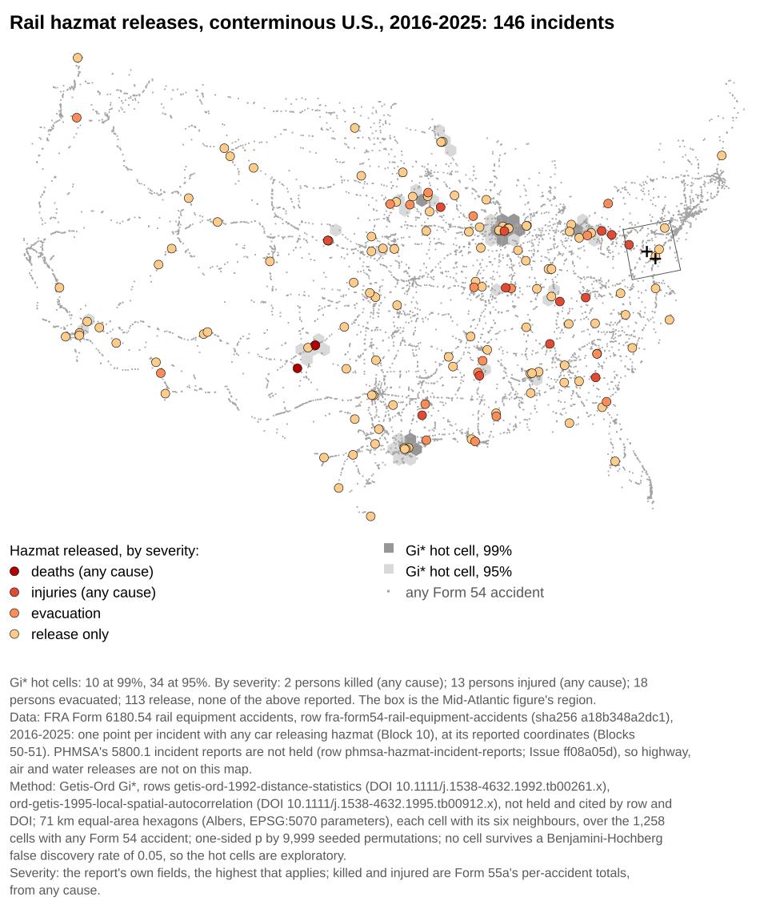

# The incident hotspot map (HB-136R)

Built by `scripts/build_incident_map.py` from `scripts/incident_map.yaml`; do not edit by hand (`--check` compares). No network and no model call: calls_made 0.

## The Mid-Atlantic figure (the deck's)

Alt text (the deck quotes it):

Map of the Mid-Atlantic region, 2016-2025: 4 rail hazmat releases (Washington DC 2016, Reading, PA 2017, Hyndman, PA 2017, Baltimore, MD 2019) coloured by severity over the grey trace of every rail equipment accident, with the Point of Rocks and Wilson Bridge fixtures marked; no Gi* hot cell lies in the region.

From 2016 to 2025, 146 rail incidents released hazmat in the conterminous U.S.; 4 of them in the Mid-Atlantic region the fixtures cover.

**Caption.** Rail hazmat releases, Mid-Atlantic (37.9 to 40.7 N, 78.95 to 75.45 W), 2016-2025: 4 incidents, each where its report puts it. Gi* hot cells in this region: none at 95%. Data: FRA Form 6180.54, Rail Equipment Accident/Incident reports, row `fra-form54-rail-equipment-accidents` (sha256 `a18b348a2dc1dfb8f18a5ecef7596f8305ddc9e2f56df88f2032d98f1be7eafe`; field list `dot-fra-form54-85tf-25kj-metadata`), held by HB-135; one point per incident (`incidentkey`) with any car releasing hazmat (Block 10), at its reported coordinates (Blocks 50 and 51). PHMSA's 5800.1 incident reports are not held (row `phmsa-hazmat-incident-reports`, rung 2; Issue ff08a05d), so highway, air and water releases are not on this map. Method: Getis-Ord Gi* (rows `getis-ord-1992-distance-statistics`, DOI 10.1111/j.1538-4632.1992.tb00261.x, `ord-getis-1995-local-spatial-autocorrelation`, DOI 10.1111/j.1538-4632.1995.tb00912.x; neither held, Wiley refusing this client (HB-135; Issue 3f4efb5a), so cited by row and DOI as DN-005 allows) on 71 km hexagons (4,365.6 km2, equal-area: Albers on GRS 80 with the EPSG:5070 parameters), each cell with its six neighbours, over the 1,258 cells with any Form 54 accident of the period; one-sided p by 9,999 permutations, seed 136. The grey trace is every located Form 54 accident of the period (20,195 incidents nationally).

| Date | Place | Railroad | Accident | Cars released | Evacuated | Killed | Injured | Damage ($) | Severity | FRA report |
|---|---|---|---|---|---|---|---|---|---|---|
| 2016-05-01 | Washington DC | CSX Transportation | Derailment | 2 | 0 | 0 | 0 | 908,859 | release, none of the above reported | CSX000159422201605 |
| 2017-03-05 | Reading, PA | Norfolk Southern Railway Company | Derailment | 1 | 0 | 0 | 0 | 18,700 | release, none of the above reported | NS124199201703 |
| 2017-08-02 | Hyndman, PA | CSX Transportation | Derailment | 3 | 1000 | 0 | 6 | 2,205,216 | persons injured (any cause) | CSX000170611201708 |
| 2019-04-21 | Baltimore, MD | CSX Transportation | Derailment | 1 | 0 | 0 | 0 | 142,770 | release, none of the above reported | CSX000182501201904 |

## Why these cells and this bandwidth

- **Cell.** The hexagons' centre spacing is the median distance from a released incident to its nearest released neighbour, 71.3 km, rounded to 71 km. A typical incident's nearest released neighbour then falls inside its Gi* neighbourhood (the cell and its six neighbours), so the statistic compares neighbourhoods that hold more than one point. A smaller cell leaves most neighbourhoods empty; a larger one merges corridors hundreds of kilometres apart.
- **Neighbourhood.** Binary weights, the cell itself included (Gi*, not Gi): a hexagon's six neighbours are all at one distance, which a square grid's eight are not. A neighbour outside the study area is left out of the sum, not counted as zero.
- **Study area.** The cells holding at least one Form 54 rail equipment accident of any kind in the period: where trains ran and had accidents. A cell with no track is not a zero.
- **p-values.** Ord and Getis 1995 is about Gi*'s distributional issues: with few neighbours and counts this sparse the normal approximation overstates significance (the TSV carries both). A cell is hot at 99% or 95% when z is above zero and its one-sided permutation p is at most 0.01 or 0.05. No cells survive a Benjamini-Hochberg false discovery rate of 0.05 over the 1,258 tests, so the hot cells are exploratory: where to look first, not a proven excess.
- **Kernel density.** Gaussian, bandwidth 71 km (the hexagon spacing, so the surface and Gi* look at one scale), on a 25 km grid, in released incidents per 10,000 km2, 2016-2025 (`docs/evidence/hb136/kde_national.json`). Planar, not along the track: network kernel density (row `okabe-satoh-sugihara-2008-network-kde-csis-dp89`, DOI 10.1080/13658810802475491, not held) is the method for points on a network and is not done here. Its five highest peaks: 41.52 N 87.69 W (1.934); 29.71 N 95.09 W (1.302); 40.77 N 81.76 W (1.2); 43.56 N 93.67 W (1.143); 34.26 N 117.38 W (0.993).
- **No partition.** No step assigns incidents to groups; the question is density.

## The national figure

146 released incidents: 2 persons killed (any cause); 13 persons injured (any cause); 18 persons evacuated; 113 release, none of the above reported. Gi* hot cells: 10 at 99%, 34 at 95% (`docs/evidence/hb136/gi_star_cells.tsv` holds every cell; `fixtures/incidents/gi_star_hot_cells.geojson` the hot ones). The hot cells, by z, with the released incidents in each neighbourhood named by their reports' own station and state:

| Centre (lat, lon) | Released in cell | In neighbourhood | z | p (perm.) | p (FDR) | Level | Stations in the neighbourhood |
|---|---|---|---|---|---|---|---|
| 41.59, -88.27 | 2 | 7 | 6.15 | 0.0002 | 0.2516 | 99% | Bedford Park, IL; Dixon, IL; Gary, IN; Joliet, IL; Matteson, IL; Plainfield, IL |
| 42.11, -87.78 | 1 | 6 | 5.69 | 0.001 | 0.4088 | 99% | Bedford Park, IL; Gary, IN; Joliet, IL; Matteson, IL; Plainfield, IL |
| 42.05, -86.92 | 0 | 6 | 5.69 | 0.001 | 0.4088 | 99% | Bedford Park, IL; Elkhart, IN; Gary, IN; Matteson, IL |
| 41.53, -87.42 | 3 | 6 | 5.15 | 0.0013 | 0.4088 | 99% | Bedford Park, IL; Gary, IN; Joliet, IL; Matteson, IL; Plainfield, IL |
| 30.26, -94.89 | 0 | 5 | 4.62 | 0.0051 | 0.9086 | 99% | Baytown, TX; Houston, TX; Mauriceville, TX; Pasadena, TX |
| 43.45, -93.80 | 0 | 5 | 4.16 | 0.0065 | 0.9086 | 99% | Albert Lea, MN; Ellendale, MN; Fairmont, MN; Graettinger, IA; Sheffield, IA |
| 41.01, -87.91 | 0 | 5 | 4.16 | 0.0061 | 0.9086 | 99% | Gary, IN; Joliet, IL; Matteson, IL; Plainfield, IL |
| 41.47, -86.56 | 0 | 5 | 4.16 | 0.006 | 0.9086 | 99% | Elkhart, IN; Gary, IN; Matteson, IL |
| 29.71, -94.53 | 0 | 5 | 4.16 | 0.0073 | 0.9183 | 99% | Baytown, TX; Houston, TX; Mauriceville, TX; Pasadena, TX |
| 41.09, -82.32 | 0 | 5 | 4.16 | 0.0065 | 0.9086 | 99% | Attica, OH; Brewster, OH; East Canton, OH; Loudonville, OH; Sandusky, OH |
| 34.54, -101.85 | 0 | 4 | 3.54 | 0.0168 | 1.0 | 95% | Amarillo, TX; Panhandle, TX; Sudan, TX |
| 29.16, -95.64 | 0 | 4 | 3.54 | 0.0174 | 1.0 | 95% | Baytown, TX; Houston, TX; Pasadena, TX |
| 29.16, -94.91 | 0 | 4 | 3.54 | 0.0164 | 1.0 | 95% | Baytown, TX; Houston, TX; Pasadena, TX |
| 41.75, -100.30 | 0 | 3 | 3.33 | 0.0275 | 1.0 | 95% | North Platte, NE |
| 34.41, -117.19 | 1 | 4 | 3.17 | 0.022 | 1.0 | 95% | Barstow, CA; Colton, CA; Ludlow, CA; San Bernardino, CA |
| 43.47, -95.56 | 1 | 4 | 3.17 | 0.0196 | 1.0 | 95% | Doon, IA; Fairmont, MN; Graettinger, IA; Sibley, IA |
| 40.72, -96.85 | 1 | 4 | 3.17 | 0.0216 | 1.0 | 95% | Fairmont, NE; Genoa, NE; Lincoln, NE; Union, NE |
| 44.01, -94.22 | 0 | 4 | 3.17 | 0.0225 | 1.0 | 95% | Albert Lea, MN; Ellendale, MN; Fairmont, MN; Graettinger, IA |
| 43.43, -92.92 | 0 | 4 | 3.17 | 0.0216 | 1.0 | 95% | Albert Lea, MN; Ellendale, MN; New Hampton, IA; Sheffield, IA |
| 41.63, -89.13 | 1 | 4 | 3.17 | 0.0245 | 1.0 | 95% | Dixon, IL; Joliet, IL; Le Claire, IA; Plainfield, IL |
| 42.16, -88.64 | 0 | 4 | 3.17 | 0.0259 | 1.0 | 95% | Bedford Park, IL; Dixon, IL; Joliet, IL; Plainfield, IL |
| 41.06, -88.75 | 0 | 4 | 3.17 | 0.024 | 1.0 | 95% | Dixon, IL; East Peoria, IL; Joliet, IL; Plainfield, IL |
| 29.72, -96.00 | 0 | 4 | 3.17 | 0.0233 | 1.0 | 95% | Baytown, TX; Houston, TX; Pasadena, TX |
| 30.27, -95.63 | 0 | 4 | 3.17 | 0.0239 | 1.0 | 95% | Baytown, TX; Houston, TX; Pasadena, TX |
| 40.96, -87.06 | 0 | 4 | 3.17 | 0.0242 | 1.0 | 95% | Dayton, IN; Gary, IN; Matteson, IL |
| 29.71, -95.27 | 4 | 4 | 3.17 | 0.0245 | 1.0 | 95% | Baytown, TX; Houston, TX; Pasadena, TX |
| 40.99, -81.48 | 2 | 4 | 3.17 | 0.0214 | 1.0 | 95% | Brewster, OH; East Canton, OH; East Palestine, OH; Loudonville, OH |
| 40.40, -81.17 | 0 | 4 | 3.17 | 0.021 | 1.0 | 95% | Brewster, OH; East Canton, OH; East Palestine, OH; Loudonville, OH |
| 40.89, -80.64 | 1 | 4 | 3.17 | 0.0215 | 1.0 | 95% | Brewster, OH; East Canton, OH; East Palestine, OH; Harmer, PA |
| 33.18, -86.41 | 0 | 4 | 3.17 | 0.0228 | 1.0 | 95% | Birmingham, AL; Irondale, AL; Jones, AL; Riverside, AL |
| 35.06, -102.28 | 0 | 3 | 2.84 | 0.0375 | 1.0 | 95% | Amarillo, TX; Panhandle, TX |
| 35.10, -101.50 | 3 | 3 | 2.84 | 0.038 | 1.0 | 95% | Amarillo, TX; Panhandle, TX |
| 35.67, -101.15 | 0 | 3 | 2.84 | 0.039 | 1.0 | 95% | Amarillo, TX; Panhandle, TX |
| 47.29, -92.27 | 0 | 3 | 2.84 | 0.0349 | 1.0 | 95% | Superior, WI |
| 35.14, -100.72 | 0 | 3 | 2.84 | 0.0395 | 1.0 | 95% | Amarillo, TX; Panhandle, TX |
| 46.72, -91.83 | 3 | 3 | 2.84 | 0.0378 | 1.0 | 95% | Superior, WI |
| 46.15, -91.41 | 0 | 3 | 2.84 | 0.039 | 1.0 | 95% | Superior, WI |
| 33.97, -89.80 | 0 | 3 | 2.84 | 0.0364 | 1.0 | 95% | Glendora, MS; Money, MS; Sardis, MS |
| 35.02, -116.96 | 1 | 3 | 2.47 | 0.0495 | 1.0 | 95% | Barstow, CA; Ludlow, CA; San Bernardino, CA |
| 42.92, -95.13 | 0 | 3 | 2.47 | 0.0462 | 1.0 | 95% | Fairmont, MN; Graettinger, IA; Sibley, IA |
| 38.30, -88.62 | 0 | 3 | 2.47 | 0.05 | 1.0 | 95% | Albers, IL; Browns, IL; Princeton, IN |
| 41.58, -81.79 | 0 | 3 | 2.47 | 0.0499 | 1.0 | 95% | Brewster, OH; East Canton, OH; Sandusky, OH |
| 37.48, -85.03 | 1 | 3 | 2.47 | 0.0498 | 1.0 | 95% | Danville, KY; Livingston, KY; Louisville, KY |
| 37.99, -84.55 | 0 | 3 | 2.47 | 0.0479 | 1.0 | 95% | Danville, KY; Livingston, KY; Louisville, KY |

## Counts against HB-127's table (step 2): they do not reconcile

`docs/evidence/hb136/counts_by_year.tsv`. HB-127's rail rows are PHMSA's, from BTS TSAR 2024 Table 5-5 (`bts-tsar-2024`, PDF p.161): hazardous materials incidents reported to PHMSA on Form 5800.1, which the same page says occur mostly in loading, unloading and storage, and the subset the table calls vehicular accident or derailment-related. This map counts FRA Form 54 incidents, rail equipment accidents "causing reportable damages greater than the reporting threshold" (`dot-fra-form54-85tf-25kj-metadata`), in which at least one car released hazmat. The definitions differ, so the counts differ, and neither is corrected to the other: the FRA count is below PHMSA's accident or derailment-related count in every year both cover.

| Year | FRA, released (national) | FRA, released (region) | PHMSA rail, all | PHMSA rail, accident or derailment-related |
|---|---|---|---|---|
| 2016 | 14 | 1 | not in table | not in table |
| 2017 | 13 | 2 | 573 | 24 |
| 2018 | 20 | 0 | 479 | 25 |
| 2019 | 15 | 1 | 413 | 23 |
| 2020 | 20 | 0 | 372 | 26 |
| 2021 | 13 | 0 | 397 | 28 |
| 2022 | 13 | 0 | 368 | 17 |
| 2023 | 12 | 0 | 332 | 15 |
| 2024 | 11 | 0 | not in table | not in table |
| 2025 | 15 | 0 | not in table | not in table |

In 2017 to 2023, the years both cover, FRA counts 106 released incidents and PHMSA 158 accident or derailment-related rail reports.

## The planning reading

EPCRA section 303(c) asks every local emergency planning committee's plan for the "identification of routes likely to be used for the transportation of substances on the list of extremely hazardous substances" and for "Methods for determining the occurrence of a release, and the area or population likely to be affected by such release" (usc-42-11003-epcra-303-2024, 42 U.S.C. 11003(c)(1) and (c)(5), PDF p.1, printed page 8096). NFPA 1620, Standard for Pre-Incident Planning (nfpa-1620-pre-incident-planning; not public, cited by title only), is the standard such a plan is written to. A hot cell on this map is a stretch of the rail network where released incidents have clustered over ten years, relative to the cells where any rail equipment accident happened; it is where a pre-incident plan for a rail release earns the most, and where a brief can be generated for a likely release point and rated by an expert in advance, before any call comes. The map shows where releases were reported, not why: it makes no claim about the causes of a hot spot, and a cell without a release is not shown to be safe, because ten years of rail releases are few points and no cell survives a false-discovery-rate correction.
