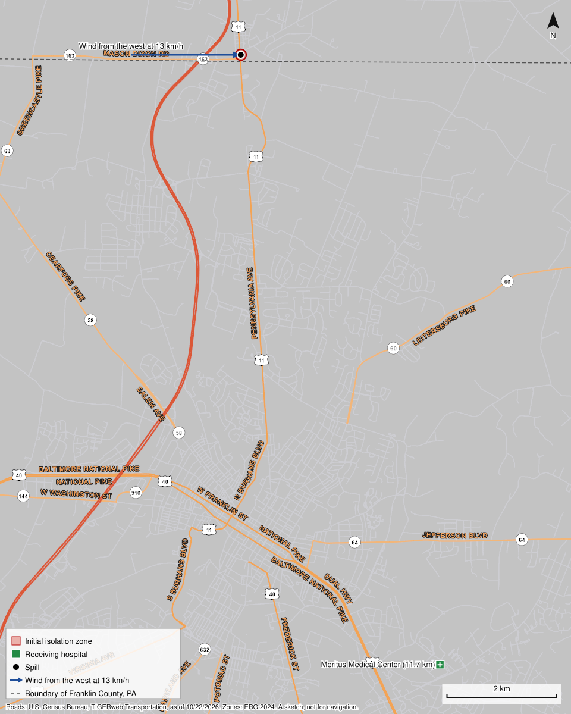

# Incident Briefing (ICS 201)

Draft for the Incident Commander to review, correct and sign. hazbrief assembled it from public data; no model wrote any sentence.

## 1. Incident Name

- Incident Name: Class 2.3 placard release, State Line, PA, 10/21/2026

## 2. Incident Number

Blank: the Incident Commander writes this block.

## 3. Date/Time Initiated

- Date: 10/21/2026
- Time: 14:00 EDT (18:00 UTC)
- As given: 2026-10-21T14:00:00-04:00

- It is daytime at the spill: sunrise 10/21/2026 07:27 EDT (11:27 UTC), sunset 10/21/2026 18:22 EDT (22:22 UTC) [ERG 2024 Table 1 how to use, sunrise and sunset by the NOAA solar equations].
- Local times are in America/New_York, the zone NWS gives for the spill point [NWS api.weather.gov points].

## 4. Map/Sketch

- No ERG app link: the app draws a named material, and none is identified.

## 5. Situation Summary and Health and Safety Briefing

### Material and protective distances

- The spill is in State Line CDP, Franklin County, PA [TIGERweb Census Current (2026), January 1, 2026 vintage].
- The material is not identified, and the placard is Class 2.3 [incident report].
- The placard table gives ERG 2024 Guide 123 [ERG 2024 Table of Markings, Labels and Placards, PDF p. 10].
- Table 1 needs the ID number or name, so Guide 123's distances apply [ERG 2024 Table 1].
- Once the ID number is known, use the material's own guide [ERG 2024 Table of Markings, Labels and Placards, PDF p. 9].
- Guide 123 is Gases - Toxic [ERG 2024 Guide 123, PDF p. 178].
- The container is unknown; the spill size is unknown [incident report].
- No fire is reported, and the spill is on land [incident report].
- The initial isolation distance is 100 m (330 feet) in all directions, the guide's immediate precautionary measure [ERG 2024 Guide 123, PDF p. 178].
- Wind is from the west at 13 km/h (8.1 mph), a moderate wind [worked example wind, as of 10/20/2026 17:40 UTC].

### Flags

- No flag rule fired for this incident.

### Population at risk

- 10 jobs are located in the footprint [LEHD LODES8 workplace area characteristics 2023, as of 12/03/2025].
- 49 residents live in the footprint [2020 Census DHC, table P1, as of 04/01/2020].
- It is daytime, so the daytime count comes first.
- 0 residents live in group quarters in the footprint [2020 Census DHC, table P18, as of 04/01/2020].
- 1 person aged 65 years and over lives in the footprint (margin of error 0 people) [ACS 2020-2024 5-year, table B01001, as of 01/29/2026].
- 0 people with a disability live in the footprint (margin of error 0 people) [ACS 2020-2024 5-year, table B18101, as of 01/29/2026].
- 0 households in the footprint have no vehicle (margin of error 0 households) [ACS 2020-2024 5-year, table B08201, as of 01/29/2026].
- 0 households in the footprint are limited English speaking (margin of error 0 households) [ACS 2020-2024 5-year, table C16002, as of 01/29/2026].
- 0 people in the footprint live in group quarters (margin of error 0 people) [ACS 2020-2024 5-year, table B26001, as of 01/29/2026].
- 0 people in the footprint have three or more components of social vulnerability [Community Resilience Estimates 2024, as of 11/26/2025].
- That is 12.34 % of 3 people, against 20.28 % nationally [Community Resilience Estimates 2024, as of 11/26/2025].
- Blocks partly inside the footprint count by the share of their area inside it.
- Daytime counts jobs located in the footprint; a worker with two jobs counts twice.

### Facilities

- 0 schools are inside the footprint [USGS National Structures Dataset, College / University and Technical / Trade School and School, Data Refreshed October, 2026].
- 0 hospitals are inside the footprint [USGS National Structures Dataset, Hospital / Medical Center, Data Refreshed October, 2026].
- 0 nursing homes are inside the footprint [CMS Nursing Home Provider Information, as of 09/30/2026].
- 0 emergency services are inside the footprint [USGS National Structures Dataset, Ambulance Service and Fire Station / EMS Station and Police Station, Data Refreshed October, 2026].
- 0 waterways are inside the footprint [USGS 3D Hydrography Program (3DHP), Data refreshed September 4, 2026].
- 0 rail segments are inside the footprint, 0 m of line [NTAD North American Rail Network Lines, updated 10/19/2026].
- 0 grade crossings are inside the footprint [NTAD Railroad Grade Crossings (FRA National Highway-Rail Crossing Inventory), updated 10/09/2026].
- The structures dataset holds selected facilities, so a school, hospital, fire station or police station it omits is not listed [USGS National Structures Dataset service description].

## 6. Prepared by

- Draft source: hazbrief 0.1.0, from public data; not a substitute for the ERG or for ICS procedures
- Pack versions: erg erg2024.5; flag_rules hb18.1; cfr172 cfr2025.1; cameo cameo3.1.0.1; hazard_classes dn001.1

- Name: blank; Incident Commander writes it.
- Position/Title: blank; Incident Commander writes it.
- Signature: blank; Incident Commander writes it.
- Date/Time: blank; Incident Commander writes it.

## 7. Current and Planned Objectives

- “Isolate spill or leak area for at least 100 meters (330 feet) in all directions.” [ERG 2024 Guide 123, PDF p. 178]
- Choose evacuation or shelter-in-place for the initial isolation zone from the ERG decision factors [ERG 2024 Protective Actions, PDF p. 286].

## 8. Current and Planned Actions, Strategies, and Tactics

Blank: the Incident Commander writes this block.

## 9. Current Organization

Blank: the Incident Commander writes this block.

## 10. Resource Summary

- 10 hospitals with emergency services are ranked within 50 km of the spill; receiving_hospitals lists every one [CMS Hospital General Information, as of 07/22/2026].

| Hospital | Beds | km | Bearing | Crosses zone |
|---|---|---|---|---|
| Meritus Medical Center | 271 | 11.7 | 162° (S) | not assessed |
| WellSpan Waynesboro Hospital | 57 | 13.6 | 76° (E) | not assessed |
| WellSpan Chambersburg Hospital | 274 | 24.5 | 15° (N) | not assessed |
| Fulton County Medical Center | 21 | 34.3 | 315° (NW) | not assessed |
| Berkeley Medical Center | 241 | 35 | 219° (SW) | not assessed |

- Beds come from the CMS Provider of Services file [CMS Provider of Services, hospital and non-hospital, as of 10/16/2026].
- Distances are straight lines from the spill, not drive times.
- Roads are not read, so a flagged hospital may have a route around the zone.
- 252 hospitals could not be placed by address and are not ranked, of 4,495 hospitals with emergency services [CMS Hospital General Information, as of 07/22/2026].

- Resource: blank; Incident Commander writes it.
- Resource Identifier: blank; Incident Commander writes it.
- Date/Time Ordered: blank; Incident Commander writes it.
- ETA: blank; Incident Commander writes it.
- Arrived: blank; Incident Commander writes it.
- Notes: blank; Incident Commander writes it.

## Annex A: Data limits and sources

### Limits

- The guide is the placard's, not the material's. Use the material's own guide once its ID number is known [ERG 2024 Table of Markings, Labels and Placards].
- With several placards, the ERG says to start with the guide needing the most protective action [ERG 2024 Table of Markings, Labels and Placards].
- No Table 1 distances: Table 1 needs the material's ID number or name [ERG 2024 Table 1].
- Guide 123 sends a spill to Table 1, which needs the material. The circle is the guide's immediate precautionary measure [ERG 2024 Guide 123].
- No verify_in_erg_app link: the ERG app draws a named material, and none is identified.
- Blocks partly inside the footprint count by the share of their area inside it.
- Area weighting assumes people are spread evenly across each block, block group and tract.
- Derived margins of error assume no covariance between cells, so they are approximate.
- A partial area's margin of error is scaled by the same area share as its estimate.
- Census block counts carry disclosure avoidance noise, so a small block's count can be off.
- Daytime counts jobs located in the footprint; a worker with two jobs counts twice.
- Daytime does not add residents who stay home during the day.
- Disability, vehicle and group quarters estimates are tract estimates, the finest the survey publishes.
- The resilience count has no margin of error; the Census Data API publishes none.
- The structures dataset holds selected facilities, so a school, hospital, fire station or police station it omits is not listed [USGS National Structures Dataset service description].
- Nursing homes are those certified by Medicare or Medicaid; assisted living facilities are not listed [CMS Nursing Home Provider Information].
- People in nursing facilities, correctional facilities, college housing and other group quarters are counted by population_at_risk, not here.
- A waterway counts once per named stream or 3DHP mainstem, and its reaches inside are summed [USGS 3D Hydrography Program].
- Drinking water intakes are not published, so waterways are listed, not intakes [Safe Drinking Water Act section 1433].
- Rail lines count by segment between network nodes, so one line can count more than once [NTAD North American Rail Network Lines].
- Grade crossings are the at-grade crossings of the FRA inventory, public and private; bridges and underpasses are not counted [NTAD Railroad Grade Crossings].
- A facility just outside the footprint is not listed unless buffer_m is set.
- Distances are straight lines from the spill, not drive times.
- Trauma level, burn care and toxicology capability are not in these datasets; confirm capability with each hospital.
- Hospitals listed are those registered with Medicare that report emergency services [CMS Hospital General Information].
- Emergency services means the hospital reports providing them, not that it has capacity now [CMS Hospital General Information].
- Bed counts are the Provider of Services bed counts, not beds available now [CMS Provider of Services].
- A hospital is flagged when the straight line to it from the upwind edge crosses the protective action zone.
- Roads are not read, so a flagged hospital may have a route around the zone.
- The footprint has no protective action zone, so distances are measured from the spill, with no crossing test.
- 252 hospitals could not be placed by address and are not ranked, of 4,495 hospitals with emergency services [CMS Hospital General Information, as of 07/22/2026].
- unplaced_in_states names the unplaced hospitals in each state listed.
- Each line is printed as the ERG prints it, with its PDF page, as a quotation.
- The incident selects the lines; `selection.omitted` names every line left out and why.
- The spill size is unknown, so the small and the large spill lines are both printed.
- The guide refers to the General First Aid section, which is not reprinted here.

### Sources

| Source | Used for |
|---|---|
| [ERG 2024 Table of Markings, Labels and Placards] | guide from the placard |
| [ERG 2024 Table 1 how to use, sunrise and sunset by the NOAA solar equations] | day or night |
| [ERG 2024 Guide 123] | guide title |
| [worked example wind, as of 10/20/2026 17:40 UTC] | wind speed and direction |
| [ERG 2024 Table 3 wind categories] | wind band |
| [TIGERweb Census 2020 tabulation geography, January 1, 2020 vintage] | geography and area shares |
| [2020 Census DHC, table P1, as of 04/01/2020] | nighttime residents |
| [2020 Census DHC, table P18, as of 04/01/2020] | group quarters by type |
| [LEHD LODES8 workplace area characteristics 2023, as of 12/03/2025] | daytime workforce |
| [ACS 2020-2024 5-year, table B01001, as of 01/29/2026] | age 65 and over |
| [ACS 2020-2024 5-year, table B18101, as of 01/29/2026] | disability |
| [ACS 2020-2024 5-year, table B08201, as of 01/29/2026] | no vehicle households |
| [ACS 2020-2024 5-year, table C16002, as of 01/29/2026] | limited english households |
| [ACS 2020-2024 5-year, table B26001, as of 01/29/2026] | group quarters population |
| [Community Resilience Estimates 2024, as of 11/26/2025] | resilience |
| [USGS National Structures Dataset, College / University and Technical / Trade School and School, Data Refreshed October, 2026] | schools |
| [USGS National Structures Dataset, Hospital / Medical Center, Data Refreshed October, 2026] | hospitals |
| [USGS National Structures Dataset, Ambulance Service and Fire Station / EMS Station and Police Station, Data Refreshed October, 2026] | emergency services |
| [CMS Nursing Home Provider Information, as of 09/30/2026] | nursing homes |
| [USGS 3D Hydrography Program (3DHP), Data refreshed September 4, 2026] | waterways |
| [NTAD North American Rail Network Lines, updated 10/19/2026] | rail lines |
| [NTAD Railroad Grade Crossings (FRA National Highway-Rail Crossing Inventory), updated 10/09/2026] | grade crossings |
| [CMS Hospital General Information, as of 07/22/2026] | hospitals and emergency services |
| [CMS Provider of Services, hospital and non-hospital, as of 10/16/2026] | beds |
| [Census Geocoder, benchmark Public_AR_Current; USGS National Structures Dataset by address, as of 10/21/2026] | hospital locations |
| [ERG 2024 General First Aid] | General First Aid |
| [TIGERweb Census Current (2026), January 1, 2026 vintage] | place and county at the spill |
| [TIGERweb Transportation, as of 10/22/2026] | Block 4 sketch roads and railroads |
| [NWS api.weather.gov points] | the spill point's time zone |
