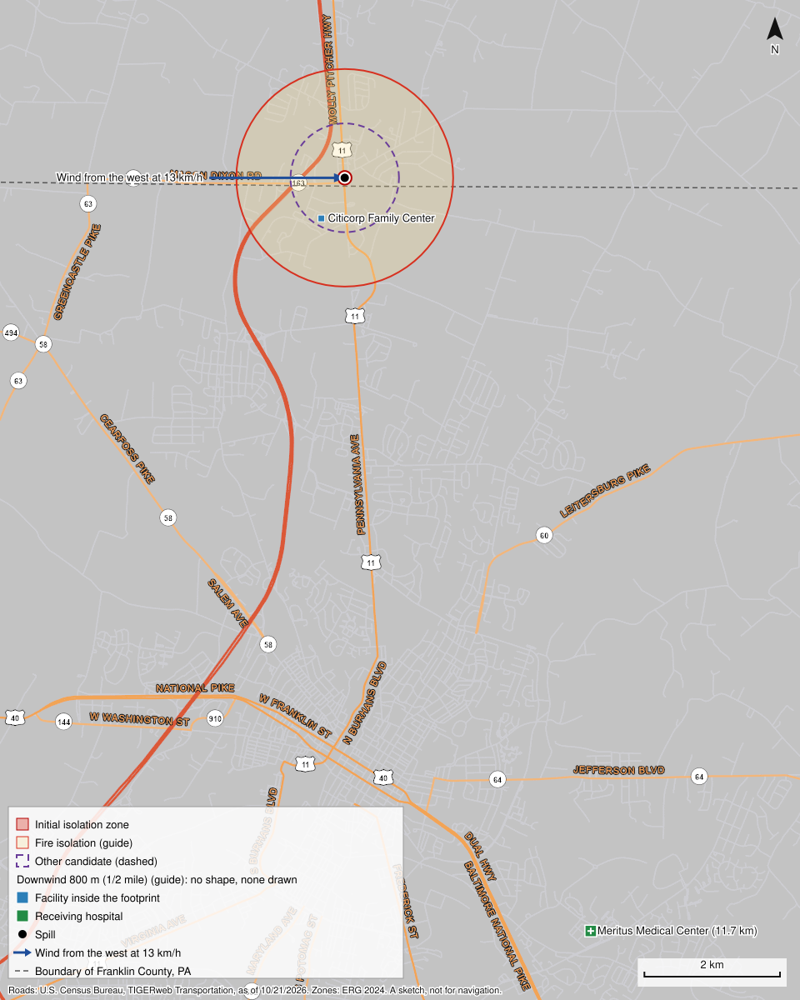

# Incident Briefing (ICS 201)

Draft for the Incident Commander to review, correct and sign. hazbrief assembled it from public data; no model wrote any sentence.

## 1. Incident Name

- Incident Name: Unresolved: UN1057 (Guide 115) or UN1057 (Guide 128) release, State Line, PA, 10/21/2026

## 2. Incident Number

Blank: the Incident Commander writes this block.

## 3. Date/Time Initiated

- Date: 10/21/2026
- Time: 14:00 EDT (18:00 UTC)
- As given: 2026-10-21T14:00:00-04:00

- It is daytime at the spill: sunrise 10/21/2026 07:27 EDT (11:27 UTC), sunset 10/21/2026 18:22 EDT (22:22 UTC) [ERG 2024 Table 1 how to use, sunrise and sunset by the NOAA solar equations].
- Local times are in America/New_York, the zone NWS gives for the spill point [NWS api.weather.gov points].

## 4. Map/Sketch

- Check against the PHMSA ERG app: https://www.phmsa.dot.gov/erg/material?materialName=Lighter%20refills%20containing%20flammable%20gas&materialUn=1057&lat=39.722&lon=-77.724&windDir=270&spillSize=large&timeOfDay=day&whereSpilled=land&windSpeed=moderate&showMap=true.
- The app may use ERG 2020 distances.
- This footprint uses ERG 2024.

## 5. Situation Summary and Health and Safety Briefing

### Material and protective distances

- The spill is in State Line CDP, Franklin County, PA [TIGERweb Census Current (2026), January 1, 2026 vintage].
- The load is not identified: as reported, it matches 2 candidates [ERG 2024 yellow index].
- UN1057, Guide 115: up to 1,600 m (1 mile), in all directions with a tank in fire [ERG 2024 Guide 115, PDF p. 162].
- UN1057, Guide 128: up to 800 m (1/2 mile), in all directions with a tank in fire [ERG 2024 Guide 128, PDF p. 188].
- The distances below are the largest, those of UN1057, Guide 115 [ERG 2024 Table of Markings, Labels and Placards introduction, PDF p. 9].
- Guide 115 is Gases - Flammable (Including Refrigerated Liquids) [ERG 2024 Guide 115, PDF p. 162].
- The container is unknown; the spill is large [incident report].
- Fire is involved, and the spill is on land [incident report].
- The initial isolation distance is 100 m (330 feet) in all directions, the guide's immediate precautionary measure [ERG 2024 Guide 115, PDF p. 162].
- For a large spill, the guide gives 800 m (1/2 mile) downwind for initial evacuation [ERG 2024 Guide 115, PDF p. 162].
- With a tank in fire, the guide isolates 1,600 m (1 mile) in all directions [ERG 2024 Guide 115, PDF p. 162].
- It also gives 1,600 m (1 mile) in all directions for initial evacuation [ERG 2024 Guide 115, PDF p. 162].
- Wind is from the west at 13 km/h (8.1 mph), a moderate wind [worked example wind, as of 10/20/2026 17:40 UTC].

### Flags

- **High: the load matches several ERG entries**
  - Fired on: 2 candidates match the load as reported [ERG 2024 yellow index, PDF p. 32].
  - Consequence: “If multiple placards point to more than one guide, initially use the most conservative guide (i.e., the guide requiring the greatest degree of protective actions).” [ERG 2024, PDF p. 9]
  - Response: “When specific information, such as ID number or proper shipping name, becomes available, the more specific Guide recommended for that material must be consulted.” [ERG 2024, PDF p. 9]
- **High: may explode when heated**
  - Fired on: fire is involved [incident report].
  - Consequence: “Containers may explode when heated.” [ERG 2024, PDF p. 162]
  - Response: “If tank, rail tank car or highway tank is involved in a fire, ISOLATE for 1600 meters (1 mile) in all directions; also, consider initial evacuation for 1600 meters (1 mile) in all directions.” [ERG 2024, PDF p. 162]
- **High: may explode when heated**
  - Fired on: fire is involved [incident report].
  - Consequence: “Those substances designated with a (P) may polymerize explosively when heated or involved in a fire.” [ERG 2024, PDF p. 188]
  - Response: “If tank, rail tank car or highway tank is involved in a fire, ISOLATE for 800 meters (1/2 mile) in all directions; also, consider initial evacuation for 800 meters (1/2 mile) in all directions.” [ERG 2024, PDF p. 188]

### Population at risk

- 1,370 jobs are located in the footprint [LEHD LODES8 workplace area characteristics 2023, as of 12/03/2025].
- 2,054 residents live in the footprint [2020 Census DHC, table P1, as of 04/01/2020].
- It is daytime, so the daytime count comes first.
- 0 residents live in group quarters in the footprint [2020 Census DHC, table P18, as of 04/01/2020].
- 106 people aged 65 years and over live in the footprint (margin of error 30 people) [ACS 2020-2024 5-year, table B01001, as of 01/29/2026].
- 209 people with a disability live in the footprint (margin of error 54 people) [ACS 2020-2024 5-year, table B18101, as of 01/29/2026].
- 15 households in the footprint have no vehicle (margin of error 10 households) [ACS 2020-2024 5-year, table B08201, as of 01/29/2026].
- 7 households in the footprint are limited English speaking (margin of error 8 households) [ACS 2020-2024 5-year, table C16002, as of 01/29/2026].
- 14 people in the footprint live in group quarters (margin of error 1 person) [ACS 2020-2024 5-year, table B26001, as of 01/29/2026].
- 207 people in the footprint have three or more components of social vulnerability [Community Resilience Estimates 2024, as of 11/26/2025].
- That is 13.33 % of 1,553 people, against 20.28 % nationally [Community Resilience Estimates 2024, as of 11/26/2025].
- Blocks partly inside the footprint count by the share of their area inside it.
- Daytime counts jobs located in the footprint; a worker with two jobs counts twice.

### Facilities

- 1 school is inside the footprint [USGS National Structures Dataset, College / University and Technical / Trade School and School, Data Refreshed October, 2026].
- Citicorp Family Center is inside the fire isolation zone.
- 0 hospitals are inside the footprint [USGS National Structures Dataset, Hospital / Medical Center, Data Refreshed October, 2026].
- 0 nursing homes are inside the footprint [CMS Nursing Home Provider Information, as of 09/30/2026].
- 0 emergency services are inside the footprint [USGS National Structures Dataset, Ambulance Service and Fire Station / EMS Station and Police Station, Data Refreshed October, 2026].
- 4 waterways are inside the footprint [USGS 3D Hydrography Program (3DHP), Data refreshed September 4, 2026].
- No waterway touches the initial isolation zone.
- Named waterways inside include West Branch Marsh Run.
- 0 rail segments are inside the footprint, 0 m of line [NTAD North American Rail Network Lines, updated 10/19/2026].
- 0 grade crossings are inside the footprint [NTAD Railroad Grade Crossings (FRA National Highway-Rail Crossing Inventory), updated 10/09/2026].
- The structures dataset holds selected facilities, so a school, hospital, fire station or police station it omits is not listed [USGS National Structures Dataset service description].

## 6. Prepared by

- Draft source: hazbrief 0.1.0, from public data; not a substitute for the ERG or for ICS procedures
- Pack versions: erg erg2024.5; flag_rules hb18.1; cfr172 cfr2025.1; cameo cameo3.1.0.1; hazard_classes dn001.1

- Name: blank; Incident Commander writes it.
- Position/Title: blank; Incident Commander writes it.
- Signature: blank; Incident Commander writes it.
- Date/Time: blank; Incident Commander writes it.

## 7. Current and Planned Objectives

- “Isolate spill or leak area for at least 100 meters (330 feet) in all directions.” [ERG 2024 Guide 115, PDF p. 162]
- “Consider initial downwind evacuation for at least 800 meters (1/2 mile).” [ERG 2024 Guide 115, PDF p. 162]
- “If tank, rail tank car or highway tank is involved in a fire, ISOLATE for 1600 meters (1 mile) in all directions; also, consider initial evacuation for 1600 meters (1 mile) in all directions.” [ERG 2024 Guide 115, PDF p. 162]
- “In fires involving Liquefied Petroleum Gases (LPG) (UN1075), Butane (UN1011), Butylene (UN1012), Isobutylene (UN1055), Propylene (UN1077), Isobutane (UN1969), and Propane (UN1978), also refer to the "BLEVE – Safety Precautions" section.” [ERG 2024 Guide 115, PDF p. 162]
- Choose evacuation or shelter-in-place for the downwind evacuation area and the fire isolation zone from the ERG decision factors [ERG 2024 Protective Actions, PDF p. 286].

## 8. Current and Planned Actions, Strategies, and Tactics

Blank: the Incident Commander writes this block.

## 9. Current Organization

Blank: the Incident Commander writes this block.

## 10. Resource Summary

- 10 hospitals with emergency services are ranked within 50 km of the spill; receiving_hospitals lists every one [CMS Hospital General Information, as of 07/22/2026].

| Hospital | Beds | km | Bearing | Crosses zone |
|---|---|---|---|---|
| Meritus Medical Center | 271 | 11.7 | 162° (S) | not assessed |
| WellSpan Waynesboro Hospital | 57 | 13.6 | 76° (E) | not assessed |
| WellSpan Chambersburg Hospital | 274 | 24.5 | 15° (N) | not assessed |
| Fulton County Medical Center | 21 | 34.3 | 315° (NW) | not assessed |
| Berkeley Medical Center | 241 | 35 | 219° (SW) | not assessed |

- Beds come from the CMS Provider of Services file [CMS Provider of Services, hospital and non-hospital, as of 10/16/2026].
- Distances are straight lines from the spill, not drive times.
- Roads are not read, so a flagged hospital may have a route around the zone.
- 252 hospitals could not be placed by address and are not ranked, of 4,495 hospitals with emergency services [CMS Hospital General Information, as of 07/22/2026].

- Resource: blank; Incident Commander writes it.
- Resource Identifier: blank; Incident Commander writes it.
- Date/Time Ordered: blank; Incident Commander writes it.
- ETA: blank; Incident Commander writes it.
- Arrived: blank; Incident Commander writes it.
- Notes: blank; Incident Commander writes it.

## Annex A: Data limits and sources

### Limits

- The packs carry every ID number's ERG rows: its Table 1, Table 2 and Table 3 entries and its guide. The hazmat table, CAMEO and hazard class rule set rows cover the seed materials only [49 CFR 172.101 Hazardous Materials Table; seeds UN1005, UN1017, UN1075, UN1202, UN1203, UN1951, UN1977, UN1978].
- The load as reported matches 2 candidates [ERG 2024 yellow index]. The distances shown are the largest among them, those of UN1057, Guide 115 [ERG 2024 Table of Markings, Labels and Placards introduction].
- Guide 115 gives 800 m (1/2 mile) downwind for a large spill, and no zone shape [ERG 2024 Guide 115]. The footprint draws none; a shape drawn for it is not the ERG's.
- verify_in_erg_app opens PHMSA's ERG app at this material, spill size, period, surface, wind and point. Compare its drawing with this footprint. Its link specification is the ERG 2020 app's. The app may draw ERG 2020 distances; this footprint uses ERG 2024.
- The container is unknown, so the link names no container. The ERG app then takes the first container it lists. This footprint takes the container with the largest distances.
- Guide 128 gives 300 m (1000 feet) downwind for a large spill, and no zone shape [ERG 2024 Guide 128]. The footprint draws none; a shape drawn for it is not the ERG's.
- Blocks partly inside the footprint count by the share of their area inside it.
- Area weighting assumes people are spread evenly across each block, block group and tract.
- Derived margins of error assume no covariance between cells, so they are approximate.
- A partial area's margin of error is scaled by the same area share as its estimate.
- Census block counts carry disclosure avoidance noise, so a small block's count can be off.
- Daytime counts jobs located in the footprint; a worker with two jobs counts twice.
- Daytime does not add residents who stay home during the day.
- Disability, vehicle and group quarters estimates are tract estimates, the finest the survey publishes.
- The resilience count has no margin of error; the Census Data API publishes none.
- The structures dataset holds selected facilities, so a school, hospital, fire station or police station it omits is not listed [USGS National Structures Dataset service description].
- Nursing homes are those certified by Medicare or Medicaid; assisted living facilities are not listed [CMS Nursing Home Provider Information].
- People in nursing facilities, correctional facilities, college housing and other group quarters are counted by population_at_risk, not here.
- A waterway counts once per named stream or 3DHP mainstem, and its reaches inside are summed [USGS 3D Hydrography Program].
- Drinking water intakes are not published, so waterways are listed, not intakes [Safe Drinking Water Act section 1433].
- Rail lines count by segment between network nodes, so one line can count more than once [NTAD North American Rail Network Lines].
- Grade crossings are the at-grade crossings of the FRA inventory, public and private; bridges and underpasses are not counted [NTAD Railroad Grade Crossings].
- A facility just outside the footprint is not listed unless buffer_m is set.
- Distances are straight lines from the spill, not drive times.
- Trauma level, burn care and toxicology capability are not in these datasets; confirm capability with each hospital.
- Hospitals listed are those registered with Medicare that report emergency services [CMS Hospital General Information].
- Emergency services means the hospital reports providing them, not that it has capacity now [CMS Hospital General Information].
- Bed counts are the Provider of Services bed counts, not beds available now [CMS Provider of Services].
- A hospital is flagged when the straight line to it from the upwind edge crosses the protective action zone.
- Roads are not read, so a flagged hospital may have a route around the zone.
- The footprint has no protective action zone, so distances are measured from the spill, with no crossing test.
- 252 hospitals could not be placed by address and are not ranked, of 4,495 hospitals with emergency services [CMS Hospital General Information, as of 07/22/2026].
- unplaced_in_states names the unplaced hospitals in each state listed.
- Each line is printed as the ERG prints it, with its PDF page, as a quotation.
- The incident selects the lines; `selection.omitted` names every line left out and why.
- The guide refers to the General First Aid section, which is not reprinted here.

### Sources

| Source | Used for |
|---|---|
| [ERG 2024 yellow index, UN1057] | ID number, names and guide |
| [ERG 2024 Table 1 how to use] | spill size |
| [ERG 2024 Table 1 how to use, sunrise and sunset by the NOAA solar equations] | day or night |
| [ERG 2024 Guide 115] | guide title |
| [worked example wind, as of 10/20/2026 17:40 UTC] | wind speed and direction |
| [ERG 2024 Table 3 wind categories] | wind band |
| [ERG 2024 yellow index] | candidates |
| [ERG 2024 Table of Markings, Labels and Placards introduction] | governing candidate |
| [TIGERweb Census 2020 tabulation geography, January 1, 2020 vintage] | geography and area shares |
| [2020 Census DHC, table P1, as of 04/01/2020] | nighttime residents |
| [2020 Census DHC, table P18, as of 04/01/2020] | group quarters by type |
| [LEHD LODES8 workplace area characteristics 2023, as of 12/03/2025] | daytime workforce |
| [ACS 2020-2024 5-year, table B01001, as of 01/29/2026] | age 65 and over |
| [ACS 2020-2024 5-year, table B18101, as of 01/29/2026] | disability |
| [ACS 2020-2024 5-year, table B08201, as of 01/29/2026] | no vehicle households |
| [ACS 2020-2024 5-year, table C16002, as of 01/29/2026] | limited english households |
| [ACS 2020-2024 5-year, table B26001, as of 01/29/2026] | group quarters population |
| [Community Resilience Estimates 2024, as of 11/26/2025] | resilience |
| [USGS National Structures Dataset, College / University and Technical / Trade School and School, Data Refreshed October, 2026] | schools |
| [USGS National Structures Dataset, Hospital / Medical Center, Data Refreshed October, 2026] | hospitals |
| [USGS National Structures Dataset, Ambulance Service and Fire Station / EMS Station and Police Station, Data Refreshed October, 2026] | emergency services |
| [CMS Nursing Home Provider Information, as of 09/30/2026] | nursing homes |
| [USGS 3D Hydrography Program (3DHP), Data refreshed September 4, 2026] | waterways |
| [NTAD North American Rail Network Lines, updated 10/19/2026] | rail lines |
| [NTAD Railroad Grade Crossings (FRA National Highway-Rail Crossing Inventory), updated 10/09/2026] | grade crossings |
| [CMS Hospital General Information, as of 07/22/2026] | hospitals and emergency services |
| [CMS Provider of Services, hospital and non-hospital, as of 10/16/2026] | beds |
| [Census Geocoder, benchmark Public_AR_Current; USGS National Structures Dataset by address, as of 10/21/2026] | hospital locations |
| [ERG 2024 General First Aid] | General First Aid |
| [TIGERweb Census Current (2026), January 1, 2026 vintage] | place and county at the spill |
| [TIGERweb Transportation, as of 10/21/2026] | Block 4 sketch roads and railroads |
| [NWS api.weather.gov points] | the spill point's time zone |
